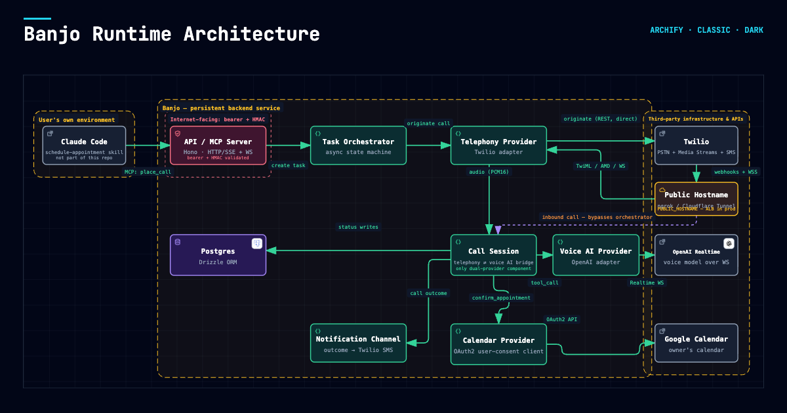

# Banjo — Architecture

## What this is

Banjo is the phone-calling half of a two-part system that lets you hand errands to Claude in normal conversation — "Schedule a haircut with Claudia," "Schedule an appointment with Dr. Smith," "Make a reservation at Luigi's for Friday at 7pm" — and have them actually get done. This half handles the outbound-calling flow described below; Banjo also supports an inbound booking line — see `src/inbound/` — gated behind `INBOUND_BOOKING_ENABLED` until you're ready to expose it.

**The other half is a Claude Code skill** (`schedule-appointment`, shipped in this repo at [`skills/schedule-appointment/SKILL.md`](../skills/schedule-appointment/SKILL.md) — symlink it into `~/.claude/skills/schedule-appointment` to install). See [Skill vs. service split](#skill-vs-service-split) for why the system is split this way and what each half owns.



---

## Skill vs. service split

Two genuinely different kinds of work are involved in "get this errand done," and they don't belong in the same place:

- **Placing a real phone call requires persistent infrastructure.** A running process holding a telephony account, streaming bidirectional audio over WebSockets to a real-time Voice AI model, for the duration of a live call — that can't be a lightweight, ephemeral thing. It has to be a deployed backend that's always on. This is Banjo.
- **Deciding how to book something, and attempting an online booking, is an open-ended per-website task.** Every business's booking flow is different — a form, a third-party platform (Vagaro, Booksy, Resy, ...), or nothing online at all. Writing bespoke scraper/API integrations into a backend for every possible booking site doesn't scale and isn't worth maintaining. Claude already has general-purpose browser automation tools, which is a far better fit for "go figure out how to book this specific website" than custom service code. This decision layer — and the online-booking attempts themselves — lives in the `schedule-appointment` skill, which calls into Banjo only when a phone call is the right move.

**Channel priority:** the skill prefers online booking when available, except where you have an established per-contact preference for calling instead (e.g. a specific business is bookable online, but you prefer a direct call there). When no preference is on file, the skill asks you once and persists the answer on the contact record (`preferredChannel`) — it doesn't re-ask on future requests to that contact, and it doesn't gate the actual time-negotiation on a live call behind a confirmation step (that stays autonomous-within-constraints; see [Error handling & state](#error-handling--state)).

---

## Architecture overview: task lifecycle

```
Steve, in conversation with Claude: "Schedule a haircut with Claudia"
  → Claude (running the schedule-appointment skill) calls find_contact("Claudia")
  → contact.preferredChannel known? if not, ask Steve once, persist via update_contact
  │
  ├─ ONLINE path (handled entirely by the skill, synchronously, via browser automation +
  │  the Google Calendar MCP tools already connected in Steve's environment):
  │     check availability → book on the site → create calendar event → record_task_outcome
  │
  └─ PHONE path (delegated to Banjo):
        Claude calls place_call(contactId, taskDescription, constraints)
        → Banjo: per-number call cap (src/tasks/callCap.ts) — for a call now, refuse if this number already
          had MAX_CALLS_PER_NUMBER_PER_DAY calls (default 3) in the last 24 hours, counting queued ones
          (a call scheduled for later is checked when it comes due instead)
        → Banjo: createTask (status: pending) → returns { taskId, ackMessage } immediately
        → Claude tells Steve: "Started calling Claudia's Salon, I'll let you know how it goes."
        → [async, in Banjo's orchestrator — src/tasks/orchestrator.ts]
           checking_availability (query Steve's Google Calendar → candidateWindows)
           → call cap checked (before the calendar lookup, then again under a per-contact lock right
             before dialing — over the cap → failed, "Call limit reached", no dial)
           → calling (build call system prompt, TelephonyProvider.originateCall() — Twilio outbound)
           → negotiating (call connects → CallSession pipes audio between TelephonyProvider ⇄ VoiceAIProvider)
              ├─ tool: check_my_availability  → live re-check if the offered time is outside candidateWindows
              ├─ tool: press_digits           → routed to TelephonyProvider (DTMF), not a backend service call
              ├─ tool: confirm_appointment    → writes event to Steve's calendar, idempotent → status: confirmed
              ├─ tool: leave_voicemail_and_end_call → status: voicemail_left
              ├─ tool: report_negotiation_failed    → status: negotiation_failed (reached a human, nothing fit)
              ├─ tool: escalate_and_end_call        → status: escalated (genuinely stuck)
              └─ tool: report_answers_and_end_call  → status: answered (mode 'ask' only — see "Ask calls")
        → NotificationChannel.notify(taskId, outcome, summary) → Steve gets a text (or a Pushover push) either way
        → Steve later asks Claude "how'd that go?" → get_task_status / list_recent_tasks
```

### Data lifecycle for one live call

```
Twilio (carrier-facing edge)
    │  outbound call originated via TelephonyProvider.originateCall()
    ▼
Call connects → CallSession created (src/session/callSession.ts)
    │
    ├─ TelephonyProvider normalizes inbound audio frames → AudioChunk (canonical PCM16, or passthrough mu-law)
    ▼
CallSession opens a VoiceAIProvider connection (factory picks impl from VOICE_AI_PROVIDER)
    │  VoiceAIProvider.connect(sessionConfig) — system instructions, tool definitions, audio format negotiation
    │
    ├─ inbound audio: TelephonyProvider → audioPipeline.inbound() → VoiceAIProvider.sendAudioChunk()
    │
    ├─ VoiceAIProvider emits normalized events:
    │     audio_chunk | transcript | tool_call | turn_end | interrupted | error | disconnected
    │
    ├─ on tool_call → CallSession looks up the tool by name, runs its handler against CalendarProvider/
    │        TelephonyProvider as needed → voiceAI.sendToolResult()
    │
    ├─ outbound audio: VoiceAIProvider audio_chunk → audioPipeline.outbound() → TelephonyProvider.sendAudio()
    │
    ▼
Call ends → CallSession.end() → VoiceAIProvider.disconnect() → notify Steve if the task reached a terminal state
```

The `CallSession` is the only component that touches both a `TelephonyProvider` and a `VoiceAIProvider` at once — neither provider layer is aware the other exists. This is what makes both sides independently swappable.

---

### Per-number call cap

At most `MAX_CALLS_PER_NUMBER_PER_DAY` (default 3) outbound calls to one phone number in any rolling 24
hours. The rule came from live testing on 2026-09-25, when five test calls went to one
friend in a single evening. The owner can override it for testing, and only narrowly: `place_call`'s
`overrideCallCap`, with the owner's key (never `MCP_AGENT_API_KEY`), for a contact tagged `family` or
whose number is the owner's own (`TRANSFER_TO_PHONE_NUMBER` or `NOTIFY_TO_PHONE_NUMBER`). Neither can be
set through MCP. It raises that call's limit to twice the cap (`OVERRIDE_CAP_MULTIPLIER`), stored on the
task as `call_cap_override` so the check before dialing uses the same limit, and nothing goes past that. The cap counts per contact (`call_attempts` joined to `tasks`). That equals
per number because `addContact` and `updateContact` store every number normalized to E.164 (libphonenumber,
the same normalizer Google Contacts sync uses) and `contacts.phone_number` is unique. Rows stored before that
are normalized at startup (`normalizeStoredPhoneNumbers`). A row whose normalized number another contact
already holds is left alone and logged, not merged. Without normalization,
"+14155551234" and "415-555-1234" would be two contacts, each with its own calls.

A support line the operator lists in `CALL_CAP_BUSINESS_NUMBERS` (`.env` only) gets
`CALL_CAP_BUSINESS_MAX` (default 10, at most 20) instead. That came from a cable company's support
line, where two calls in a row died in its phone menu and three tries weren't enough to file a
ticket. A business line is an IVR and a call centre, not someone's own phone, which is what the cap
protects. The list can't be set through MCP, for the same reason as `relationshipTier`.

It's enforced in two places:

- **`place_call`**, for a call that should start now. It checks before creating anything, and it also
  counts calls that are due and about to dial, so a burst of requests can't queue past the cap. A call
  scheduled for later isn't checked here: by the time it's due, today's calls may have left the
  window.
- **The orchestrator**, for every call, right before dialing. It does one quick check before the
  calendar lookup, and the check that counts runs under a per-contact lock spanning the check, the move
  to `calling`, and the call-attempt insert. The lock is chained in-process and backed by a Postgres
  advisory lock (`pg_advisory_xact_lock`), so two due calls can't both pass, even in separate processes
  on the same database (e.g. `npm run test:call` alongside `npm run dev`). At most 4 contacts' locked sections run at once per
  process: each holds a pooled connection in the lock's transaction while its work needs another, and the
  pool's default of 10 would otherwise run dry and hang every query. A call over the cap becomes
  `failed` ("Call limit reached…") and the owner is notified. If inserting the call attempt fails,
  the task is failed rather than left in `calling`.

The refusal gives the time the next call fits: when enough counted calls have left the window. If queued
calls alone fill the cap, it says so instead, because they haven't started yet.

What counts: every call attempt Banjo inserts. That includes an attempt whose dial then failed (bad
number, Twilio error), so a debugging session that burns three failed dials uses up the day's cap for
that number. Inbound calls and the transfer leg to the principal don't count, since Banjo didn't
originate them. The window is rolling, not per calendar day.

## Voice AI abstraction layer (`src/voice/`)

A normalized `VoiceAIProvider` interface (`src/voice/types.ts`), EventEmitter-style: `connect(config)`, `sendAudioChunk(chunk)`, `sendToolResult(id, result, isError?)`, `interrupt()`, `triggerResponse()`, `sayVerbatim(text)`, an optional `verbatimDeliveryReport()`, `disconnect()`, emitting a normalized `VoiceAIEvent` union (`connected | audio_chunk | transcript | tool_call | turn_end | interrupted | error | disconnected`). Canonical internal audio format is PCM16; each adapter negotiates/converts to its vendor's actual wire format. Tool definitions are Zod schemas (`src/voice/tools/callTools.ts`) converted once to JSON Schema and injected identically into every provider.

Four adapters (`src/voice/providers/{openai,openaiLive,gemini,elevenlabs}.ts`):

- **OpenAI Realtime** — `session.update` for config/tools, `input_audio_buffer.append` inbound, `response.output_audio.delta` outbound (GA event name — renamed from the beta `response.audio.delta`), function-calling via `conversation.item.create`/`response.create`. Supports G.711 µ-law passthrough — when paired with Twilio, audio can skip resampling entirely.
- **OpenAI GPT-Live** (`VOICE_AI_PROVIDER=openai-live` — ships dark: tested on live calls, but not the default) — `gpt-live-1`, a full-duplex voice front-end that delegates reasoning and tool calls to a separate Responses backend model (`OPENAI_LIVE_BACKEND_MODEL`). `session.start` on `wss://api.openai.com/v1/live/sessions`; tool schemas go under `delegation.responses.tools`, function calls arrive nested in `response.event`, and results return via `response.item.create` + `response.create`. The voice layer gets a narrower prompt (`VoiceAISessionConfig.frontendInstructions`, built by `buildCallFrontendPrompt`/`buildInboundFrontendPrompt` from `buildFrontendSystemPromptGuidance`) while the backend gets the full one. Two capabilities the rest of the system relies on don't exist on this wire and are synthesized inside the adapter: `turn_end` (an output-idle debounce — there is no `response.done`; GPT-Live streams digital-silence frames between utterances, which the adapter drops so they don't count as speech) and verbatim delivery (speak-then-verify: `sayVerbatim` appends an instruction, then `verbatimDeliveryReport()` compares the output transcript using `src/voice/verbatimMatch.ts`, and `leave_voicemail_and_end_call` records `voicemail_left` only on a match, escalating otherwise). `interrupt()` is a no-op. µ-law passthrough, with one audio format shared by both directions. Open risks #15–22.
- **Gemini Live** — hard-requires 16kHz PCM16 input / 24kHz PCM16 output; always needs the codec layer. Exact WebSocket message envelope names (setup/tool-call/tool-response) were not confirmed during design and are marked NEEDS VERIFICATION in the source.
- **ElevenLabs Conversational AI** — `conversation_initiation_client_data` init, `user_audio_chunk`/`audio` events, tool calls via `client_tool_call`/`client_tool_result` (ElevenLabs expects the WS client — us — to execute tools, which maps directly onto our tool registry). Also supports mu-law passthrough.

Provider selection is a factory/registry (`src/voice/factory.ts`) keyed by the `VOICE_AI_PROVIDER` env var. Adding a future provider (Grok, etc.) means: implement `VoiceAIProvider`, register it in the factory, add its env vars — nothing else in the codebase changes. (GPT-Live needed one additive exception: the optional `frontendInstructions` prompt and `verbatimDeliveryReport()` seam described above, which every other provider ignores.)

---

## Telephony gateway (`src/telephony/`) — outbound origination

```ts
export interface TelephonyProvider {
  originateCall(opts: { to: string; callId: string; answeringMachineDetection?: boolean }): Promise<{ providerCallId: string }>;
  sendAudio(callId: string, chunk: AudioChunk): void;
  sendDigits(callId: string, digits: string): Promise<void>; // DTMF, for IVR navigation
  interrupt(callId: string): void; // flush outbound buffer on caller barge-in
  hangUp(callId: string): Promise<void>;
  on(event: 'event', listener: TelephonyEventListener): void;
}
```

`TelephonyProvider` is kept as its own interface (rather than folded directly into `TwilioProvider`) so `CallSession` and its tests depend on a vendor-neutral audio-in/audio-out and control-action contract, the same seam `src/voice/`'s `VoiceAIProvider` abstraction uses. Twilio is the only implementation today — a LiveKit adapter was scaffolded early on but never got past non-functional audio I/O placeholders and carried zero live traffic, so it was removed rather than kept as unmaintained dead code (see git history around the `TELEPHONY_PROVIDER` env var if resurrecting a second provider is ever needed).

- **`providers/twilio.ts`** — `client.calls.create({ to, from, url: <TwiML that <Connect><Stream>s to our WS> })`. The provider can also request Twilio's Answering Machine Detection (`answeringMachineDetection: true` → `machineDetection: 'Enable', asyncAmd: true`, result via a status-callback webhook), but outbound calls no longer do: its verdict misread business greetings as machines (Open Risks #23).
- **`dtmf.ts`** — the `press_digits` tool routes to `TelephonyProvider.sendDigits()`, not a domain/backend service. This is a deliberate architectural distinction from the calendar/task-backed tools in `voice/tools/callTools.ts`: DTMF is phone signaling, not AI speech, even though it's registered with the Voice AI provider exactly like any other tool.
- **`audio/codec.ts`** — `muLawToPcm16`, `pcm16ToMuLaw`, `resamplePcm16`. `src/session/audioPipeline.ts` resolves which conversion (if any) is needed once per call, based on `(telephony's native format, negotiated voice-AI format)`. When both sides support mu-law directly (OpenAI/ElevenLabs paired with Twilio), it's pure passthrough — a real latency/CPU win. A naive linear-interpolation resampler is used for v1; a proper resampling library is a flagged future upgrade, not a blocker.

### Call transfer (#7)

`transfer.ts` (next to `dtmf.ts`, same reasoning: this is phone signaling, not AI speech) defines
`transfer_to_owner` — a cold hand-off of the live call to `TRANSFER_TO_PHONE_NUMBER`, offered to the
model only when `TRANSFER_ENABLED` is on, gating both the tool and the prompt rule that tells the
model when to use it (`transferSection` in `systemPrompt.ts`). Each direction supplies its own
`onTransferred` hook — outbound (`callSessionAdapter.ts`) moves the task to `transferred`; inbound
(`inbound/tools.ts`) texts the owner — so the telephony layer stays ignorant of tasks. On
`openai-live`, whose voice layer has no tools, the voice-layer delegation guidance also gains one line
saying that connecting the caller is its backend's job, again only when the flag is on.

`<Connect><Stream>` is terminal TwiML: the Media Streams WebSocket *is* the call, so there's no
TwiML continuation inside the call to `<Dial>` into. A transfer has to be a REST redirect of the
live call instead — `client.calls(sid).update({ twiml })` — the same call shape `hangUp()` already
uses. `TwilioProvider.transferCall()` builds `<Dial timeout="20" answerOnBridge="true" action=".../transfer-callback?callId=…"><Number url=".../transfer-screen?callId=…">{to}</Number></Dial>` (the screen is described below). Nothing follows the `<Dial>` in that
TwiML: with an `action` URL, Twilio never reaches verbs after it and instead runs whatever TwiML the
callback returns, so the fallback line has to live there rather than after the `<Dial>`.

**The callback** (`POST /telephony/twilio/transfer-callback`, `src/server.ts`) is where the dial's
outcome actually arrives — after the `<Dial>` ends, via `DialCallStatus`. It maps that to a
`transfer_result` (`answered | no_answer | busy | failed`; a picked-up dial counts as `answered` only if the principal accepted it at the screen), records it on `call_attempts` for
outbound calls (inbound calls have no `call_attempts` row, so it just logs), and returns
`<Hangup/>` when answered or the XML-escaped fallback `<Say>{TRANSFER_FALLBACK_MESSAGE}</Say><Hangup/>`
otherwise. This is also why there's no `transfer_completed`/`transfer_failed` arm on
`TelephonyEvent`: the dial result is known only once the bridged call ends, by which point the
`CallSession` that placed the transfer is already gone and has no listener left to notify. A failed
*redirect* (the REST call itself, not the eventual dial outcome) is a different, immediate failure —
`transferCall()` throws, and the tool returns `transfer_failed` to the model directly.

**Screening (#74).** A carrier voicemail answers a dial just like a person. On the 2026-09-26 live test, the principal let the transfer ring, their voicemail picked up inside the 20s timeout, and Twilio reported the dial `completed`. The result was recorded as `answered`, and the caller was bridged into voicemail without ever hearing the fallback line. So the `<Number>` carries a `url` (`POST /telephony/twilio/transfer-screen`) that runs on the principal's leg once it picks up, before it is bridged, while the caller keeps hearing ringing (`answerOnBridge`). It says "Your AI assistant is transferring a call to you. Press 1 to take it." twice in a one-digit `<Gather>`. A 1 (`/transfer-screen-result`) is remembered in `TwilioProvider.acceptedTransfers`, and the reply is just "Connecting.", which ends the screen, so Twilio bridges the call. Any other key, or silence, which is what a voicemail greeting gives, falls through to `<Hangup/>` on the principal's leg only. The callback counts a `completed`/`answered` dial as `answered` only if that transfer was accepted, and as `no_answer` otherwise, so the caller hears `TRANSFER_FALLBACK_MESSAGE`. A transfer counts as accepted only if this process saw the key press (`takeTransferAccepted`, read once). Twilio's `DialBridged` would survive a restart and hold across processes, but its docs don't say whether a voicemail picking up before the screen hangs up counts as bridged. If it does, trusting it brings this bug back, so it is logged but not trusted. Revisit once a live call shows its value for both an accepted and a voicemail transfer. The record is kept in memory because inbound transfers have no `call_attempts` row. So a restart between the key press and the callback reports an accepted transfer as `no_answer`, and the caller hears the fallback line after the bridged call. An entry whose callback never arrives is swept after 4 hours, Twilio's default `<Dial>` time limit. The principal's voicemail still records the prompt before the hang-up.

`transferCall()` stops any running recording before redirecting: the callee agreed to a recorded
call with Banjo, not to recording the principal's bridged conversation, and stopping it is also the
consent boundary — recording never continues into a call leg the disclosure rule never covered.

The call is forgotten (`forgetCall`) only *after* the REST redirect succeeds, unlike `hangUp()`,
which forgets in a `finally`. Two things ride on that: `isAnyCallActive()` has to drop back to false
so the inbound line doesn't stay wedged, and — the sharper reason — `CallSession`'s teardown
`hangUp()` becomes a no-op via `recentlyEnded` once the call is forgotten. Without that, a teardown
that runs before Twilio's stream `stop` event arrives would hang up the call Banjo just bridged to
the principal. If the redirect fails, the call is *not* forgotten: it's still Banjo's to keep
talking on, and the stream's `stop`/close handlers forget it whenever it genuinely ends either way.

**Timing.** The tool is the one live-call handler not wrapped in `runToolSafely`'s `TOOL_TIMEOUT_MS`.
That timeout can't cancel anything, and once the redirect is sent the call may already be with the
principal: an 8s timeout firing mid-redirect told the model the transfer failed (so it escalated, or
hung up a call being bridged), and the handler returning early let `end()` mark the task `failed`
before the redirect landed. Instead the tool declares `VoiceTool.handlerBudgetMs`
(`TRANSFER_HANDLER_BUDGET_MS`: the playback wait, plus the SDK's 30s timeout for each of
`transferCall()`'s two REST calls, plus one `TOOL_TIMEOUT_MS` to record it — ~74s, a ceiling for a
stuck call, not a normal duration). `CallSession` re-arms its tool-pending watchdog with that budget
after the `endsCall` turn_end wait, and `toolBudgetMs` gives `end()`/`fail()` the same allowance, so
a stream `stop` that arrives before Twilio's REST response still waits for the handler to record
`transferred`. Every other tool's budget is unchanged. One side effect for every tool: the watchdog's
first arm now clears any timer already running, and the watchdog records the tool call that armed it.
Before, a second concurrent tool call left the first call's timer running unreferenced, and whichever
call finished first cleared the watchdog. Now the newer call's watchdog replaces it, and only that
owner clears it or sets the call back to `active` when it finishes. While a call-ending tool runs, no
other tool call re-arms it (see below). Benign: only concurrent tool calls see any of this.

**Nothing else can end the call while a call-ending tool runs.** While any `endsCall` tool's handler is
in flight (`CallSession.callEndingToolCallId`), `CallSession` refuses a new *call-ending* tool call with
`{ ok: false, error: 'call_ending' }` without running it, and the silence watchdog neither arms nor
nudges. Otherwise a nudged `end_call` accepted during a slow redirect could hang up the call
mid-transfer. Non-ending tools still run: one OpenAI response can carry `end_call` and
`confirm_appointment` together, and the booking must land (`end()` waits for it as for any in-flight
handler). The tool-pending watchdog belongs to the call-ending tool for that time: no other tool call
re-arms it, and a tool finishing mid-transfer neither clears it nor sets the call back to `active`.
When the handler returns — including a `transfer_failed` with the call still Banjo's — all of this
goes back to normal, so the model can then escalate or end the call as the prompt says.

**Notification.** The outbound hook only records the outcome; `end()`'s `notifyIfTerminal` sends the
one text when the stream stops, as for every other outcome. If recording it throws, the hook retries
once and logs at error with the task id; if both fail, the task stays in progress and `end()` marks it
`failed` — the text then says failed although the call was handed over.

**An already-confirmed task.** A common case is a restaurant that books the table, then asks for a
card to hold it, and Banjo transfers. The task is already `confirmed` (terminal), so `transitionTask`
refuses the `transferred` write and the task keeps saying `confirmed` — which is still true. The
transfer shows only on the call attempt: `call_attempts.transfer_result`, written by the callback.
The owner's text is the confirmation; nothing tells them the call was handed to them afterwards other
than their phone ringing.

### Warm transfer (`TRANSFER_MODE=warm`, #149)

Opt-in, and not yet verified on a live call. Default `cold` is everything above. In warm mode the same
`transfer_to_owner` tool reaches the principal on a **second line** while the other party stays on
Banjo's media stream, so Banjo is still with them throughout:

1. The model asks them to hold ("Let me see if Steve can join. It may take a minute…"), then calls the
   tool. Its `reason` (at most 300 characters) is now a **brief**, read to the principal.
2. `TwilioProvider.loopInOwner()` places a separate call (`calls.create` with inline TwiML, 25s ring) to
   `TRANSFER_TO_PHONE_NUMBER`. It plays a fixed greeting, the brief, and "Press 1 to talk to them now.
   Or hang up, and I'll carry on without you." That's two one-digit `<Gather>`s, then `<Hangup/>`.
   The brief comes from the call, but it is XML-escaped and only ever read to the principal.
3. **On 1** (`POST /telephony/twilio/loop-in-result`): stop any recording, as on a cold transfer.
   Then REST-redirect the other party's call to `<Dial><Conference endConferenceOnExit="true">banjo-{callId}</Conference></Dial>`.
   That ends Banjo's stream, and the principal's leg joins the same room with "Connecting." Either
   side hanging up ends the conference. The call is forgotten as after `transferCall()`, the tool
   returns `ok`, and the task becomes `transferred`, as on a cold transfer.
4. **Anything else.** These all settle with the call still Banjo's, and the owner's leg is gone:
   - a different key (`declined`);
   - the owner's leg ending with no key: busy, unanswered, or their voicemail, since a greeting
     never presses 1 (`/loop-in-status` → `no_answer`);
   - `LOOP_IN_TIMEOUT_MS` (60s) passing;
   - the other party hanging up first (`forgetCall` hangs up the owner's line).

   The tool returns `{ ok: false, error: 'owner_unavailable', result }`, with a message telling the
   model to say in one sentence that the principal isn't available, carry on, and not try again.
   Nobody is bridged into voicemail.

`call_attempts.transfer_result` gets `answered`, `declined` or `no_answer` from the tool handler, so
a timeout is recorded too. The handler budget grows by the wait and one REST call
(`WARM_TRANSFER_HANDLER_BUDGET_MS`, about 2¾ minutes by default), and the rest of the call-ending-tool machinery above
applies unchanged. While the tool waits, nothing else can end the call and the silence watchdog
doesn't nudge, but the other party can still talk to Banjo. The prompt tells Banjo to say only that
it's still trying (Open Risk #24 is what makes it reply at all).

Decisions for #149:
- **Recording** stops at the bridge, as on a cold transfer. There's no setting to keep it: the other
  party agreed to a recorded call with Banjo, not with the principal.
- **The per-number cap** doesn't count the principal's leg. It isn't a `call_attempts` row, it only
  ever rings the principal's own configured number, and that number must press 1 to be connected.
- **Pending loop-ins** live in memory (`TwilioProvider.loopIns`), like `calls`. A restart mid-wait
  drops the call anyway.
- **A late 1**, after the wait is over, gets "Sorry, that call has already ended."

Not covered: if the principal's leg drops in the moment between their 1 and joining the conference,
the other party sits alone in a silent conference until they hang up.

The sim covers all three answers with no phone: `npm run sim -- --warm --owner accept|decline|no-answer`.

---

## Data model (`src/contacts/`, `src/tasks/`)

**`contacts`** — shared by the skill (via MCP tools) and the calling flow:

```ts
{
  id, displayName, phoneNumber,           // E.164
  category,                                // salon | medical | restaurant | home_services | other
  preferredChannel,                        // 'phone' | 'online' | null — null = the skill asks once, then sets this
  bookingUrl,                              // for the skill's online-booking path
  notes,                                   // free text, injected into the live-call system prompt as context
}
```

**`tasks`** — generalized across both channels, so `list_recent_tasks` gives Steve one unified history:

```ts
{
  id, contactId, channel,                  // 'phone' | 'online'
  goalDescription, constraints,            // { dateWindows?, durationMinutes?, notes? }
  status, candidateWindows,                // phone path only — precomputed offerable slots
  outcome, calendarEventId,
}
```

**`call_attempts`** — child of a phone-channel task, tracks call *mechanics* separately from the task's *business outcome*:

```ts
{ id, taskId, providerCallId, status, answeredBy, disclosed, recordingSid, startedAt, endedAt, errorDetail }
```

`disclosed`: whether the first thing Banjo said on the call included "AI" (#8, `session/disclosure.ts`), or null if it never spoke. Outbound calls are prompted to open with `DISCLOSURE_LINE`, but that's a prompt rule, not an enforced line; this column is the after-the-fact check. A miss is also noted in the owner's notification. If the silence watchdog has to nudge before Banjo has said anything, the nudge cues the disclosure line (`CallSessionOptions.openingLine`) instead of an open-ended response: on a v0.1.4 voicemail the model rightly stayed quiet through the carrier's greeting, the open-ended nudge made it say "One moment.", and the call opened without disclosing (#118).

`recordingSid`: the Twilio recording, when `RECORD_CALLS` is on (#8). `CallSession` starts it (`TelephonyProvider.startRecording`, two-track) only once the turn in which Banjo said a recording notice (added to the opener by `disclosureLine()`) has ended *and its audio has finished playing* (`audioPlaybackTracker.estimatedDoneAt()` + 500ms). A final transcript arrives when the model has written the line, not when the phone has played it: on the first live test that was ~4s early, before the notice was heard. An interruption before the turn ends cancels the pending start. Because disclosure is a prompt rule, not enforced, this is what guarantees nothing is recorded before the other party is told. Outbound only. `recordings/retention.ts` deletes recordings from Twilio after `RECORDING_RETENTION_DAYS` (default 30), at boot and then daily, and clears the column; a refused delete keeps the id for the next sweep.

**`call_transcript_turns`** (`src/transcripts/`) — what was said, one row per finalised line, written only when `PERSIST_TRANSCRIPTS=true` and deleted after `TRANSCRIPT_RETENTION_DAYS` (default 30; 0 = forever):

```ts
{ id, callAttemptId | inboundCallId,   // exactly one (check constraint); ON DELETE CASCADE
  seq, role, text,                      // seq: per-call arrival order, assigned by CallSession
  quality,                              // 'ok' | 'suspect' — see session/transcriptQuality.ts (#25)
  voiceProvider, spokenAt, createdAt }
```

Written through `CallSessionOptions.onTranscript`, fire-and-forget: a failed insert is logged and never touches the call. Deliberately not through `transitionTask`, whose compare-and-set refuses writes once a task is terminal — the calls most worth a transcript. Read back by the `get_call_transcript` MCP tool, which names every gap: suspect lines, a Gemini call with only Banjo's side (Gemini requests no input transcription), saving switched off. `seq` is the order lines went *final*: under full duplex the other party's line can land just after Banjo starts replying.

**Status lifecycle** (phone path):

```
pending → checking_availability → calling → negotiating
                                               ├─→ confirmed
                                               ├─→ voicemail_left
                                               ├─→ negotiation_failed   (reached a human, nothing fit)
                                               └─→ escalated            (AI got stuck)
any state → failed (technical/telephony error)   |   any pre-terminal state → cancelled
```

Separating `CallAttempt.status` (call mechanics) from `Task.status` (business outcome) distinguishes three failure shapes that need different framing when Steve is notified: "the call machinery broke" vs. "the call worked but nothing bookable came of it" vs. "the AI gave up mid-conversation." `src/tasks/service.ts`'s `transitionTask` is the only function that writes `Task.status`/`outcome`, avoiding races.

Online-path tasks skip the calling-specific intermediate states entirely — the skill logs them directly into a terminal status via `record_task_outcome`.

---

## Asynchronous tool interface for appointment scheduling

Tool schemas (`src/voice/tools/callTools.ts`, `src/telephony/dtmf.ts`) are Zod schemas — the single source of truth, converted once to JSON Schema (`src/voice/tools/defineVoiceTool.ts`) and injected identically into every provider's session config.

- **`check_my_availability(date, time, durationMinutes)`** — live query against Steve's calendar, used when the other party proposes a time outside the precomputed `candidateWindows` (which are an optimization/starting point, not the source of truth).
- **`confirm_appointment(confirmedStart, durationMinutes, details?)`** — writes the event to Steve's calendar. The idempotency key is derived **server-side** from `callAttemptId`, never trusted from model output — LLMs are unreliable at generating/reusing idempotency keys across retries. This means a dropped call right after a successful booking can't cause a duplicate calendar event if anything retries the tool call. Does **not** end the call itself — see `end_call` below.
- **`leave_voicemail_and_end_call(message)`**, **`report_negotiation_failed(reason)`**, **`escalate_and_end_call(reason)`** — the three distinct non-success terminal paths (see status lifecycle above); each ends the call itself.
- **`end_call(summary?)`** — the successful-completion path: ends the call after `confirm_appointment` has already recorded the outcome. Added after a real call was cut off mid-sentence because no existing tool represented "task succeeded, hang up cleanly" — the model reached for an ill-fitting tool instead. Doesn't set an outcome itself; if called without a prior outcome-setting tool having run, it's a safety net that marks the task `escalated` rather than leaving it stuck `negotiating` forever.
- **`press_digits(digits)`** — telephony-layer, not a domain-service tool (see Telephony gateway above).

**Ending a call without cutting off speech:** `TelephonyProvider.hangUp()` is a REST call that ends the Twilio leg immediately, but a tool call and the model's still-streaming trailing audio aren't sequenced against each other — there's no signal available for "the trailing audio has actually finished playing on the PSTN leg," only for when we finished sending chunks over the WS. All four call-ending tools go through `hangUpAfterSpeaking()` (`src/voice/tools/callTools.ts`), a pragmatic fixed grace period (2.5s) before the REST hangup fires — not a precise fix, but long enough for a short trailing sentence to finish playing. Caught for real on a live call: "Haircut appointment confirmed by phone for..." cut off mid-sentence before this existed.

**Timezone:** `CALENDAR_TIMEZONE` (IANA identifier, default `America/New_York`) is the single source of truth for what "2pm" means on a call and how times are written to the calendar — injected into the system prompt so the model knows which zone to speak in, and applied via `src/lib/timezone.ts`'s `zonedTimeToUtcIso()` (a dependency-free, DST-aware naive-local-time → UTC converter) wherever a tool receives a date/time. A real booking once landed 4 hours off (2pm requested, 10am on the calendar) because nothing told the model or the calendar-write path which zone was intended, and a bare `"2026-08-04T14:00:00"` with no offset was silently parsed as UTC.

**Handling calendar-API latency during a live call:** the shared system prompt (`src/voice/systemPrompt.ts`) instructs the model to tell the caller it's checking before waiting on a tool result — cheap, provider-agnostic, no architecture needed. Backed by a per-tool timeout (`TOOL_TIMEOUT_MS`, default 8s, via `src/lib/withTimeout.ts`) that returns a structured error the model can react to rather than hanging, and a session-level watchdog (`CallSession`) for tool calls stuck longer than expected regardless of cause.

**Voicemail vs. human vs. IVR:** the model decides by listening. Twilio's AMD was tried as a telephony-layer signal and dropped — it read business greetings as voicemail (Open Risks #23). IVR menu navigation has no equivalent concrete signal — genuinely the least deterministic part of the system. The model listens to the menu transcript and calls `press_digits` when it identifies a relevant option; `escalate_and_end_call` is the honest fallback when it can't parse the menu, capped at a couple of attempts to avoid looping against a machine that won't accept what it keeps trying. Treat this path as best-effort, not reliable.

**Who answered (#187):** the model still decides by listening, but `CallSession` now also judges the
other party's first line out of band (`VoiceAIProvider.judgeFirstLine`, OpenAI only, the same
text-only, tool-less, `conversation: 'none'` check as a hold line), and judges a second line only if
the first was `uncertain`. The verdict, `human | voicemail | ivr | uncertain`, goes into
`call_attempts.answered_by`, and the log line `judged who answered` has how long the judgment took
and whether Banjo had already spoken by then (`banjoSpokeFirst`), which is what live calls need to
measure before the verdict could gate anything. It only steers: on `voicemail`,
`session/answerCheck.ts` adds a fixed system note (`addContext`, no reply prompted) pointing at
`leave_voicemail_and_end_call`, and the note says a person speaking still wins. An `ivr` note was
tried and dropped: arriving right after "para español, oprima dos", it made Banjo press 2 on
menu-on-hold in 3 of 3 runs, so a phone system is only recorded. Nothing is refused and nothing hangs up on a verdict. A short or unclear line
counts as a person, the opposite of Twilio AMD's bias. Outbound only (`judgeFirstLine` in the
session options); the inbound line doesn't judge. Each eval scenario names the verdicts it allows
(`expect.answeredBy`, check `answered_by`), so the scenario set also grades the judge.

---

## Calendar (`src/calendar/`) — two separate integration points, by design

- **The skill's online-booking path** uses the Google Calendar MCP tools already connected in Steve's Claude Code environment directly — synchronous, inside the conversation, no reason to proxy through Banjo.
- **Banjo's phone-call path** has its own direct calendar client, because it must act autonomously during a live call, entirely outside any Claude conversation. `CALENDAR_PROVIDER` picks it through `src/calendar/factory.ts`:
  - **`google`** (default, `googleCalendarProvider.ts`) — Google Calendar API, OAuth2 user-consent flow (not service-account domain-wide delegation, which is the wrong fit for a personal calendar).
  - **`caldav`** (`caldavCalendarProvider.ts`) — any CalDAV server (Fastmail, iCloud, Nextcloud), HTTP Basic with an app password. Availability comes from a `calendar-query` REPORT with the server expanding recurring events (`<C:expand>`); an unexpanded recurring event or a truncated (507) result fails the check rather than reporting busy time as free. What counts as busy matches Google's freebusy: cancelled, free (`TRANSP:TRANSPARENT`) and owner-declined events don't block, and all-day events block only when marked busy. A booking's resource name is a hash of its idempotency key, written with `If-None-Match: *`, so the server itself refuses a duplicate create — see Open Risks #8. `npm run dav:check` lists an account's calendars and address books and shows what Banjo will treat as busy, without writing anything.

  Both share the slot math in `src/calendar/freeSlots.ts`.

This is a deliberate duplication, not an oversight — the two paths genuinely can't share one client given their different execution contexts.

---

## Contacts (`src/googleContacts/`, `src/carddavContacts/`)

`CONTACTS_PROVIDER` picks where the local contacts cache comes from: `google`, `carddav`, or `none`. Everything past the sync — the cache-first lookup, provisioning into `src/contacts/`, the relationship-tier heuristic — is the same for both; the cache table and its `googleResourceName` column keep their Google-era names, and CardDAV rows use `carddav:<vCard UID>` there.

- **`src/carddavContacts/`** — a CardDAV address book (Fastmail, iCloud, Nextcloud), signed in with the same `DAV_*` app password as the CalDAV calendar. Reads with a `sync-collection` REPORT (RFC 6578): the first sync after boot reads everything and prunes the cache to match, including rows left by a previous Google setup; later syncs send the token and apply only what changed, falling back to a full read if the token has expired or a group card changed. Group labels come from both group cards (`KIND:group` / Apple's `X-ADDRESSBOOKSERVER-KIND`) and `CATEGORIES`; relations from `RELATED` and Apple's `X-ABRELATEDNAMES` labels. The live fallback on a cache miss is "sync, then re-check the cache" rather than a server-side search, because vCards store phone numbers as typed and a text search for an E.164 number would miss.
- **`src/googleContacts/`** — Google People API integration (same OAuth client as `src/calendar/`, a broader granted scope). A periodic full sync keeps a local cache of the principal's Google Contacts fresh; a cache-first lookup layer (with a live-API fallback on a miss, bounded by a hard timeout) resolves phone numbers/names for both directions — outbound `find_contact` and inbound caller ID — and auto-provisions/backfills matches into `src/contacts/`. See `docs/superpowers/specs/2026-09-07-google-contacts-integration-design.md` for the full design.

**A returning caller (#129).** When caller ID resolves an inbound caller to a contact, and the carrier fully attests that caller ID (STIR/SHAKEN A, Twilio's `StirVerstat` = `TN-Validation-Passed-A`, `isFullyAttested`), `src/inbound/recentCalls.ts` looks up Banjo's outbound calls to that contact dialed in the last 48 hours (at most 3, newest first; counted from the dial, so a missed call counts), and `buildRecentCallsGuidance` (`src/inbound/systemPrompt.ts`) adds them to both inbound prompts. Each entry is Banjo-written: when, how it ended, and the task's goal, given as the owner's instructions but kept private. The voicemail they were left is model-written, so it goes in JSON-quoted and marked as data, like the webhook's `text`/`outcome` split. A call's summary is never included: it can hold what was said on the call (a live one held a gate code). The attestation check is there because caller ID can be spoofed, and these entries carry the owner's instructions. Without it, the caller gets the usual flow. A caller returning a message or a conversation gets it carried on. One returning a call that was booking or agreeing to something gets nothing agreed and no `book_appointment` (that's for booking time with the principal), and `flag_for_owner_and_end_call` passes on what they offered. No lookup happens for an unknown caller, and the lookup fails closed to none.

---

## MCP server (`src/mcp/`)

Exposed over **HTTP/SSE (remote MCP)**, since Banjo runs as a persistent AWS service rather than being spawned locally by Claude Code — the endpoint requires a bearer token (`MCP_API_KEY`) since it's internet-reachable. Tools:

- **`place_call(contactId, taskDescription, constraints, mode?, scheduledFor?)`** → creates a phone-channel `Task`, fires off orchestration asynchronously — or, with `scheduledFor` (a local date-time interpreted in `CALENDAR_TIMEZONE`), leaves it `pending` until the orchestration poller finds it due, within 15 seconds of that time (a periodic poller also picks up any non-terminal task, so this is self-healing across a container restart), returns `{ taskId, ackMessage }` immediately.
- **`get_task_status(taskId)`**, **`list_recent_tasks(limit?)`** — status/history lookups.
- **`get_call_transcript(taskId)`** — what was said on a task's calls, line by line, when `PERSIST_TRANSCRIPTS` is on; notes every gap (suspect lines, one-sided Gemini calls, saving off). See `call_transcript_turns` above.
- **`cancel_task(taskId)`** — calls off a phone task that hasn't dialed yet (`pending` or `checking_availability`, typically a scheduled call); a call already underway or finished is left alone, and the orchestrator re-checks the status its own transitions return so a cancel racing a starting run still stops it before dialing.
- **`find_contact(query)`**, **`list_contacts(category?)`**, **`add_contact(...)`**, **`update_contact(id, { preferredChannel?, bookingUrl?, notes? })`** — contact directory management.
- **`record_task_outcome(contactId, goalDescription, outcome)`** — lets the skill log a completed online booking into the same task history as phone-based tasks.

### Agent calls need the owner's approval (`MCP_AGENT_API_KEY`)

Always-on agents (Hermes, OpenClaw) read untrusted text: webhook payloads, transcripts, messages. A
"confirm before calling" rule in their prompt can be skipped by a steered or confused agent, and a call
is the one action here that can't be taken back. So the gate is in Banjo, keyed on the credential:

- `requireAuth` returns a role: `owner` for `MCP_API_KEY`, `agent` for `MCP_AGENT_API_KEY`. An SSE
  session keeps the role it was opened with.
- An agent's `place_call` runs every normal check, then creates a `pending` task with
  `approval_expires_at` 30 minutes out, and sends the owner a message (`sendOwnerMessage`) with a link to
  `/approve/<taskId>?sig=…`. If the message can't be sent, the task is cancelled. At most 3 requests wait
  at once. `overrideCallCap` is refused.
- `sig` is an HMAC of the task id and its deadline, keyed from `MCP_API_KEY`, which the agent doesn't
  hold. Nothing is stored. The link is never logged (the request log redacts `sig`), returned by a tool,
  or put in the webhook.
- `GET /approve/:taskId` shows the request, escaped; only the page's button (`POST`) approves, so a link
  preview can't. Approving is a compare-and-set on `approved_at`, then `triggerOrchestration`.
- The orchestrator never claims a task waiting for approval. The poller cancels unapproved ones once
  their deadline passes (`transitionTask` with `unapproved: true`, so it can't land after an approval).
- `get_task_status` and `list_recent_tasks` add `approval: 'waiting' | 'approved' | 'not_approved'` to
  such tasks.
- The page shows everything the call will use: the task's notes, windows, length and hold limit, and the
  contact's notes. The message shows the notes and leaves the rest to the page. Both label the contact's
  name, before it: only the address book's own name for the number (`addressBookNameFor`, from the
  contacts cache) is shown as from the address book. Any other name is labelled typed in, including one an
  agent gave a number that was later linked to an address-book entry (reconcile never overwrites
  `displayName`), and it's shown as the name used on the call. An agent can `add_contact` a stranger as
  "Mom". For a `family` or `friend` contact, both also say that the call may answer questions about the
  owner from their profile. Invisible direction and zero-width marks are dropped from agent text.
- The approval message must reach the owner somewhere the agent can't read: anyone with the link can
  approve. With an agent that reads the owner's texts, use Pushover, not `twilio_sms`. The agent key can't set a contact's notes (`add_contact` and
  `update_contact` refuse), since they go into every call to that contact and could otherwise change a call
  after it was approved, nor its booking URL, which Claude Code opens when it books online for the owner.
  At most 3 requests wait at once; the check and the insert run under one lock (`withApprovalRequestLock`).
  A request the agent cancels keeps its place until its 30 minutes are up (`countOpenApprovalRequests`), so
  cancelling and asking again can't flood the owner with messages.
- The agent key can't use up the owner's calls or stop them. The owner's `place_call` cap check leaves out
  agent requests still waiting for approval (each is counted again before it dials), and the agent key's
  `cancel_task` and `stop_call` reach only calls it asked for (`askedByAgent`).
- Startup fails if the agent key is set without `PUBLIC_HOSTNAME`, with `NOTIFICATION_CHANNEL=none`, or
  equal to `MCP_API_KEY`.

Design: `docs/superpowers/specs/2026-10-14-place-call-approval-design.md`.

---

## Error handling & state

- **Telephony socket drops mid-call:** no auto-resume is possible (PSTN doesn't support it) — `CallSession` disconnects the Voice AI leg immediately (avoids leaking billed connection time), records the failure, and the task moves to `failed`. Steve has to call back himself; that's a hard constraint of telephony, not a design gap.
- **Voice AI provider errors:** each adapter is responsible for surfacing errors via the normalized `error` event; `CallSession`'s current v1 behavior is to fail the call attempt rather than attempt an in-session reconnect (a reconnect-with-condensed-context-replay is a reasonable v1.1 addition, deliberately out of scope for the initial scaffold — these are short calls, so a failed attempt surfacing to Steve promptly is an acceptable v1 behavior).
- **Mid-call provider swap** is architecturally possible (both `TelephonyProvider` and `VoiceAIProvider` are swappable independently, and nothing in `CallSession` assumes a specific vendor) but not wired up as an automatic trigger — intentional scope, not a gap.
- **Appointment booking state — the critical correctness property:** Postgres is the source of truth, never "whatever the model said out loud" and never Google Calendar alone. `confirm_appointment`'s server-generated idempotency key (see above) means a call dropping immediately after a successful booking is not data loss — the row/event is already durably confirmed — just a UX gap where Steve might need to check `list_recent_tasks` to see it if he didn't hear the confirmation live.
- **Autonomous booking authority:** the AI can finalize/confirm on the call as long as the offered time fits the constraints Steve gave upfront — no mid-call check-back. This is a deliberate choice (see Skill vs. service split) distinct from channel selection, which *does* get a one-time check-in with Steve when unknown.

---

## Ask calls (`mode: 'ask'`, #148)

`place_call` with `mode: 'ask'` and 1–5 `questions` finds something out and books nothing. The
questions are stored in `tasks.questions`. The differences from a booking call:

- **No calendar.** The orchestrator skips the date-window check and the free-time lookup
  (`candidateWindows` is `[]`), and `outboundToolsFor()` (`src/tasks/callSessionAdapter.ts`) leaves
  out `bookingCallTools` (`check_my_availability`, `confirm_appointment`,
  `undo_confirmed_appointment`, `report_negotiation_failed`). An appointment length isn't put in
  the prompt. The prompt
  (`askModeGuidance()` in `src/tasks/promptBuilder.ts`) replaces the booking instructions with the
  numbered questions, and says to decline out loud any offer to book, order or reserve something,
  or to put something on hold for the principal. Being asked to hold the line is not such an offer:
  Banjo waits, as on any call. Each question must be on one line (`place_call` refuses a line break,
  and the prompt collapses whitespace too): answers are matched by the list's numbers.
- **What Banjo gives out.** A status question ("is my prescription ready?") can't be answered
  without a name. Banjo may give the principal's name and details from the task's goal or notes
  when the other party needs them to answer, and nothing else; the owner-profile rule is unchanged.
  Asked for a deposit, payment or other personal details, Banjo says it can't give that and carries
  on asking. When transfer is on, those are what only the principal can give, so the transfer
  rules apply instead (the #148 review found the two rules contradicting each other).
- **Read-backs.** Banjo says each answer back as it goes, so a misheard answer gets corrected while
  the person is still on the line. Once they confirm a read-back (or that they don't know), the
  prompt has Banjo call `record_answer` silently, so answers are kept as they go. It must not end
  the call in the same turn as the last read-back, and ends with `report_answers_and_end_call`,
  not `end_call`. Tool names stay out of the voice-layer prompt, as for every mode. On
  `openai-live` the backend acts only when the voice layer delegates, so the voice-layer prompt
  (`askModeFrontendGuidance()`) tells it to delegate saving each confirmed answer, silently; without
  that line `record_answer` never ran mid-call there.
- **Shared rules without the booking lines.** `buildBaseSystemPromptGuidance` and
  `buildFrontendSystemPromptGuidance` (`src/voice/systemPrompt.ts`) take `purpose: 'ask'`, and on
  it the shared sections drop what only fits a booking: waiting for a clear yes to a specific time,
  restating an offered time, saying what was booked, "So shall I book Friday at 10?", and the
  "Yes, Friday at 10 works." example. Two lines are swapped for ask versions: a hedged answer is
  said back as hedged (not pushed for a firm yes), and the no-callback rule loses "an unavailable
  time" and "offer alternatives". "Handling tool calls" adds that saving an answer is silent, with
  no filler before it, since the filler rule otherwise covers every action. Booking and
  conversation prompts are byte-for-byte what they were (the #148 review, round 2).
- **Saved as it goes.** `record_answer` (ask calls only, doesn't end the call) saves one answer as
  soon as the other party confirms the read-back, into `tasks.collected_answers`: jsonb keyed by
  question number, a later save for the same number replacing the earlier. It's written only by
  `saveCollectedAnswer()` (`src/tasks/service.ts`), merged in the UPDATE itself, never through
  `transitionTask` (whose compare-and-set would drop a save that lands as the call ends) and
  without touching `updatedAt`. Before this (the #148 review), answers lived only in the ending
  tool's arguments, so anything that ended the call first lost all of them: the business saying
  "yep, bye" and hanging up, a refused goodbye followed by a hang-up, a hold limit, a transfer.
- **Its own ending.** `report_answers_and_end_call` (`requiresGoodbye`, like the other normal
  endings) moves the task to `answered`, with the outcome `{ kind: 'answered', answers, summary? }`.
  The model reports answers by question number, and `answersFor()` (`src/tasks/answers.ts`) pairs
  them with the stored question text. It starts from the saved answers and lets the final report
  override them: the last report for a number wins, so a correction later in the list replaces
  what came before. The outcome therefore always has one entry per question, in order. An entry
  with `answered: true` but no answer text is recorded as unanswered, and `TaskAnswer` is a
  union (`answered: true` always has `answer`), so the compiler holds every writer to that.
- **Ending early.** A call that ends with the task still unfinished (the far end hangs up, the
  session fails, or the stale-call sweep finds its process died) is recorded from the saved
  answers: `answered`, every question present, and a Banjo-written summary saying the call ended
  before Banjo could wrap it up (`unfinishedCallOutcome` in `src/tasks/modes.ts`). With nothing
  saved it's `failed`, as before.

`answers[].answer` and `summary` are written by the voice model from what was said on the call, so
they are untrusted data like every other free-text outcome field. The webhook `text` gives counts
only ("Banjo asked X 3 questions: 2 of 3 answered."). The owner's summary opens with the same count
and lists each question and answer. The status is `answered` even when nothing was, so a call with
no answers reads as one: the summary opens "No answers from X", the webhook text says "0 answered"
and both say it needs the owner, and on Pushover it's titled "Banjo: no answers" and sent urgent
(`needsAttention()` in `src/notifications/channel.ts`). Five questions with long answers can pass
Pushover's 1024 characters or Twilio's 1600 (Twilio rejects the text, so nothing arrives), so
`buildOutcomeSummary` fits the summary to `OWNER_SUMMARY_MAX_CHARS`: each question and answer is
clipped to an equal share, the free-text summary is clipped and then dropped, every question keeps
its number and "(no answer)", and a last line points to `get_task_status` for the full answers. The
summary is built before the channel is known, so it fits the smaller of the two. `sendSms` also
clips any body to 1600 as a backstop.
Voicemail, escalation, transfer and a hold limit work as on any call and keep their own status and
outcome; the answers saved before them show in `get_task_status`'s `collectedAnswers` (ask tasks
only, each question paired with its saved answer). `list_recent_tasks` leaves them out rather than
pass on the raw map, which is keyed by question number without the questions, and the skill checks
`get_task_status` for them. The owner's summary lists them after that outcome's own
line (`withSavedAnswers()`, fitted to the same limit), and the webhook text adds a count only ("It
saved 1 of 3 answers first."). `end_call` with no outcome recorded first
records the call `answered` from the saved answers, rather than `escalated`.

**One definition per mode.** `src/tasks/modes.ts` holds what differs by mode: `books` (calendar
lookup and date-window check, booking tools, booking prompt lines), what `end_call` records when
nothing was recorded first, and what a call that ended unfinished records instead of `failed`.
`outboundToolsFor()` adds each mode's own tools (its ending, and `record_answer` for ask) from a map
keyed by mode. Both are `Record<Task['mode'], …>`, so a new mode can't leave one out. Ask mode first spread
its differences across string checks and missed three (the #148 review). `place_call` refuses
`dateWindows` on an ask call.

**The simulator** (`npm run sim -- --mode ask --question …`) parses its input with
`placeCallInputSchema` before anything is created, so it refuses what `place_call` would, with the
schema's message. It passes no `durationMinutes` or `dateWindows` on an ask call. It used to pass
both on every run, and once `place_call` refused date windows on ask calls, every ask run was refused.

## Waiting on hold (`wait_on_hold`, #151)

Outbound calls on OpenAI Realtime can wait in a hold queue. Other providers aren't offered the tool or the prompt section; see `canWaitOnHold()`.

**Going on hold.** The prompt's "Phone menus and holding" section has Banjo press through the menu silently. Once it hears a queue, it calls `wait_on_hold`, saying nothing. That tool's `startsHold` flag makes `CallSession` do four things:
- send the tool result with `respond: false`;
- call `VoiceAIProvider.setHold(true)`;
- stop the silence watchdog (on hold, silence is the point);
- start the hold limit.

On OpenAI, `setHold(true)` resends `audio.input` with `turn_detection: { type: 'server_vad', create_response: false, interrupt_response: false }`. Turns are still detected and transcribed, but never answered. Each held turn is then deleted (`conversation.item.delete`) once transcribed. A long hold's audio therefore neither fills the context nor gets billed as input on the first reply after it. What the hold costs is transcription.

**Is it a person?** Each new held line goes through `isRepeatOnHold()` (`src/session/hold.ts`) first. A line whose wording mostly matches one already heard on this hold is skipped, since queues repeat the same announcement every half minute. Anything new goes to `judgeHoldLine()`, an out-of-band response with these settings:
- `conversation: 'none'`: nothing enters the call's conversation;
- `output_modalities: ['text']`: no audio, so the other party hears nothing;
- `tools: []` and `tool_choice: 'none'`: the line is the other party's words and could ask for anything, so
  the judgment can't act on it. The adapter also drops any function-call event from an out-of-band
  response;
- tagged in `metadata`, so the adapter keeps its text and `response.done` from looking like Banjo speaking.

It returns one word: PERSON or RECORDING. Judgments run one at a time, and only the latest line that arrived meanwhile is judged next. A failed or late judgment (8s) counts as a person: a person left in silence hangs up, while Banjo woken by a recording can go back on hold.

**A person picks up.** `setHold(false)` runs and the owner gets a message. Then `VoiceAIProvider.addContext()` adds two conversation items:
- a fixed system note (`personPickedUpNote`): open again with the AI disclosure, since they heard nothing from before the hold;
- what they said, as a user line.

Then a plain response is triggered. This deliberately isn't a `triggerResponse(cue)`: a cue *replaces* the session's instructions for that response, which would drop the call's rules and put the other party's words in instruction position. From there Banjo carries on, and can use the warm transfer (#149) like any call.

**Recording consent: nothing is recorded after a hold.** Whoever picks up heard none of the recording notice, so the rest of the call isn't recorded at all.
- **Before the hold starts,** `CallSession` calls off any scheduled start and sets the recording state to `'cancelled'`, which never re-arms.
- **Then, on every recorded call, it runs `TelephonyProvider.stopRecording`,** whatever that state says. On Twilio this lists the call's recordings and stops each one `in-progress` or `paused`, plus the recording this process started even if the list doesn't show it (Twilio's lists can lag). The list covers a recording whose start reached Twilio while its response, and so its SID, never reached Banjo. If any start failed after it was sent, the stop still stops what it finds but then throws, so that call never waits on hold: Twilio may have begun that recording without listing it yet, and no list can confirm otherwise. `Twilio.CURRENT` isn't used, since it fails when a call has more than one active recording. The stop throws if the call is unknown or Twilio can't be asked.
- **The reopening** after a pickup uses the disclosure without the notice (`pickupLine`, `disclosureLineWithoutNotice()`), since saying "this call is recorded" would now be false.
- **Start and stop run one at a time** (`recordingOps`), so a stop can't overtake a start still in flight.
- **Fails closed:** if the stop can't be confirmed, `wait_on_hold` is refused. No hold starts if the call ended while the recording was being stopped.

This replaced a pause-and-resume design that re-established consent with the new person. Three rounds of security review each found a gap in its state machine, and keeping the recording off after a hold has no such state machine at all. The cost: the conversation with whoever picks up after a hold, usually the part that matters, isn't recorded.

**Limits.** A hold lasts at most `HOLD_MAX_MINUTES` (default 20, at most 45), or the task's `constraints.maxHoldMinutes`. It's always cut short to leave 10 minutes of the voice session to talk in, since OpenAI ends a session at 60 minutes with no warning (`VoiceAIProvider.maxSessionMs`). No time left means `wait_on_hold` is refused. Running out ends the call as `escalated` with `stuckAt: 'hold_limit'`. A menu Banjo can't get through is `escalated` with `stuckAt: 'phone_menu'`, from `escalate_and_end_call`. The owner hears when a hold starts (with its limit) and when someone picks up. A hold that runs out reaches them as the usual end-of-call summary.

**Not covered yet:**
- **The other provider.** `openai-live` can't hold.
- **Barge-in on hold.** Server VAD still raises `interrupted` on the hold music. On hold that only flushes audio Banjo isn't sending.
- **Real queues.** The judge's accuracy on them is unmeasured: the sim covers the flow (`~` lines in a `--script` play like a recording), not real hold audio.


## Working through a problem with a person (2026-10-18)

**Why.** On 2026-10-18 Banjo got through Xfinity's phone menu and reached an agent, who asked for verification digits Banjo didn't have. Banjo transferred the call to the owner. What followed was long and frustrating:
- the frontline script couldn't take in the evidence;
- the call ended without a clear plan for what the technician visit would check.

None of it was captured: a cold transfer drops Banjo off the line, and `transferCall` stops any recording. Two changes came out of it.

### Asking the owner mid-call (`ask_owner`, `ASK_OWNER_ENABLED`)
**When Banjo uses it.** When the other party asks something the task doesn't cover, Banjo says it'll check, which may take a minute or two, and uses `ask_owner`. It never guesses.

**The tool.**
- It's offered on outbound calls on OpenAI Realtime only, because the answer comes back through `VoiceAIProvider.addContext`.
- It returns as soon as the question is sent, so the tool budget never covers the wait.

**The message and the link** (`src/ownerQuestions/`):
- The question is saved in `owner_questions`, at most 3 open per call.
- It's sent through `sendOwnerMessage()` as urgent, with a signed `/answer/:id` link. Banjo's words and the link come first, ahead of the model-written question.
- The link's signature is keyed from `MCP_API_KEY` under its own label (`banjo-answer-v1`), so an approval signature can't answer a question and an answer signature can't approve a call.

**The answer page.**
- GET only shows the question, so a link preview can't answer anything.
- POST saves the answer once, at most 500 characters, before the question expires.

**Getting the answer back into the call.**
- The answer reaches the call through the live-call registry, as a fixed note (`answerNote`) with the question and answer quoted, via `CallSession.relayOwnerNote`.
- It waits for any reply in progress to finish first. On hold, it's held until the hold ends.
- If no answer comes within `ASK_OWNER_TIMEOUT_SECONDS`, a fixed note says so: don't guess; carry on, offer to connect them if transfers are on, or escalate.
- Questions and answers are deleted along with transcripts (`TRANSCRIPT_RETENTION_DAYS`).

**Conduct rules for every outbound call** (`workingWithThemSection` in `voice/systemPrompt.ts`). These apply whether or not `ask_owner` is on:
- answer from the task;
- get any ticket or case number, and ask them to note the details on it;
- ask for someone more specialized when their steps don't fit the problem;
- keep it about the process, never the person;
- with transfers on, hand the call over only for what needs the principal, and only once any ticket is settled.

### The transcript after a transfer (`TRANSCRIBE_TRANSFERS`)
**Consent, by fixed audio.** Banjo is off the call by then, so consent can't depend on what the model says. Both notices are fixed:
- the other party hears a `<Say>` before the `<Dial>`: "This call will be recorded.";
- the principal's press-1 screen says "This call is recorded." first.

**Recording.** The `<Dial>` records `record-from-answer-dual`: channel 1 is the original call (the other party), channel 2 the principal.

**Transcribing** (`transcripts/transferLeg.ts`):
- The recording-status callback, with its Twilio signature checked, hands the recording sid to `saveTransferLeg`.
- It fetches the WAV by sid from the account's own API path, never from a URL in the webhook, and splits the channels.
- It transcribes each channel with `whisper-1`, which gives segment timestamps, and merges them by time.
- The merged lines are appended after Banjo's lines as leg `transferred`, with role `owner` for the principal.
- Then the recording is deleted from Twilio. That happens even when transcription fails, after 3 tries: recording retention only knows the recordings in `call_attempts.recording_sid`.
- `get_call_transcript` marks those lines `afterTransfer`, with speaker `owner`.

**Not covered yet:**
- **Warm transfers.** A conference recording is mixed to mono, so the two sides can't be told apart.
- **The screening prompt.** It may show up as text on the owner's channel.
- **A live call.** This hasn't been tested on one yet.

## Text-mode simulator (`src/sim/`, `scripts/sim.ts`)

`npm run sim` places a call that's real everywhere except the phone line: the `place_call` handler,
the orchestrator, the outbound `CallSession` adapter, the system prompt, every tool, and the rows in
Postgres. Three things are swapped, each through an `override…Provider()` seam in its factory
(`telephony/factory.ts`, `voice/factory.ts`, `calendar/factory.ts`), which nothing in `src/` sets:

- **Phone line:** `SimTelephonyProvider`. It "answers" on the next tick, and reports digits, hang-ups
  and transfers instead of carrying them out.
- **Calendar:** `SimCalendarProvider`, in memory. It's free 9 to 6 in `CALENDAR_TIMEZONE`, with two
  meetings tomorrow, and follows the real providers' idempotency and double-booking rules.
- **Voice transport:** `OpenAIRealtimeProvider` in text-only mode. That's the same adapter and model,
  but with `output_modalities: ['text']` and no audio config. Typed lines go in through
  `sendUserText()`, which reports them as final user transcripts, so `CallSession` treats them
  exactly like transcribed speech.

`src/sim/env.ts` runs before config is imported. It forces everything that could reach the outside
world off: no notifications, webhook or recording. It points `DATABASE_URL` at `banjo_sim` on the
same server, and the sim refuses to empty any database with another name.

**What it can't show:** anything that lives in audio. That includes server VAD and barge-in, pickup
noise and echo (#143), the playback timing behind `hangUpAfterSpeaking`, and whether
`sayVerbatim`'s words were actually spoken. With no audio, `estimatedAudioDoneAt` is always "now".
Text replies can also differ a little from spoken ones. Use the sim for what Banjo says and which
tools it calls, and a real call for how it sounds.

### Scenario evals (`evals/`, `src/evals/`, #188)

A scenario (`evals/scenarios/<id>.yaml`, schema in `src/evals/scenario.ts`) is a sim call with a
script for the other party and expectations: the final status, tools called or not (with argument
matches), a booking's local day and time, numbers Banjo may say only if the call said them first,
phrases it never says, and a goodbye within N lines of a cue. Every scenario also gets the universal
checks: disclosure first, disclosure once, and a goodbye before the call ends (not for voicemail,
transfer or escalation). Scripts write dates as `{day+N}`, rendered in the scenario's time zone,
since Banjo isn't reliably given today's date and reads relative days ("the day after tomorrow")
loosely. The env is fixed (`src/evals/env.ts`): owner "Alex", a fictional profile, New York time,
`gpt-realtime`, and nothing from your `.env` but `OPENAI_API_KEY` and `DATABASE_URL`.

Two tiers run from the same files:

- **Live:** `npm run eval` runs each scenario `--runs` times (default 3) against real OpenAI, each run
  in its own child process (`scripts/eval-run.ts`). It prints pass rates, the safety nets that
  rescued a call (`src/evals/rescues.ts`: a refused ending, the fixed goodbye, a goodbye or "still
  there?" cue, the opener cue), and the estimated cost from the session's token usage. Results go
  to `evals/results/<timestamp>/` (git-ignored). It only warns: a drop against `evals/baseline.json`
  larger than the noise (1/runs) is flagged, never failed. `--save-baseline` writes the baseline
  from a full run. `--record` saves a passing run of each scenario to `evals/recordings/`.
- **Replay:** `tests/evals/replay.db.test.ts`, in `npm test` and CI, plays each recording back through
  the real call path with no model: `CallSession`, its safety nets, the tools and Postgres run for
  real, and `ReplayVoiceAI` returns the model's recorded side once the code makes the same calls it
  did live. A different call or tool result is a divergence and fails the test. A recording whose
  prompt or tools changed (its fingerprint, over the instructions and tool JSON with UUIDs and
  timestamps normalized) is stale: skipped with a warning to re-record, never a pass. So is one whose
  scenario file changed.

Recordings hold only the fictional scenario's words, never a real call's.

---

## Configuration

Zod-validated env schema (`src/config/index.ts`), parsed and validated at process start (imported first in `src/index.ts`) — the process fails fast on a missing/invalid value rather than discovering it mid-call. See `.env.example` for the full list of variables; cross-field `.refine()` checks enforce that only the credentials matching the *selected* `VOICE_AI_PROVIDER`/`TELEPHONY_PROVIDER`/`NOTIFICATION_CHANNEL` are required.

---

## Open risks / things to verify during real implementation

This list was written at design time, before any real-call testing had happened. Since then the project has been almost entirely live-call-driven (place a real call → read logs → fix the exact root cause), which has resolved some of these items and left others untouched. Triaged below by what actually needs doing next, not by original numbering.

See also [`docs/COMPETITIVE_LANDSCAPE.md`](COMPETITIVE_LANDSCAPE.md): a research pass comparing this project's `src/voice/`/`src/telephony/` abstraction against dedicated open-source frameworks (Pipecat, LiveKit Agents, Vocode, Bolna) that solve the same problem, and the roadmap for if/when wrapping one of them underneath the existing `VoiceAIProvider`/`TelephonyProvider` interfaces becomes worth doing.

### Must fix before any use beyond your own local live-testing

_(none currently open — #14 below was the one item here, now fixed)_

### Should fix soon (active call path, unverified, but degrades rather than breaks)

_(none currently open — #12 below was the one item here, now fixed)_

### Defer (theoretical, low-probability, or already-accepted tradeoff)

8. **[OPEN, accepted for v1]** `GoogleCalendarProvider`'s idempotency check-then-insert has a small race window (two near-simultaneous calls with the *same* idempotency key could both pass the check before either inserts) — this is distinct from the double-booking guard added in `d523f83` (which checks whether the slot is free at all) and remains exactly as originally documented. Requires near-simultaneous duplicate calls with the identical key; this system is single-caller-at-a-time by design, so real-world likelihood is low. A Postgres-backed idempotency table would close it fully if concurrent usage ever becomes real. Doesn't apply to `CaldavCalendarProvider`: its create is a conditional `PUT` (`If-None-Match: *`) to a key-derived resource name, which the server makes atomic.
9. **[OPEN, accepted tradeoff]** Naive linear-interpolation resampler (`src/telephony/audio/codec.ts`) is correctness-only, not production audio quality — already self-documented as an accepted v1 tradeoff. Only exercised on the Gemini path, which isn't the active provider, so it currently affects nothing live.
23. **[FIXED — AMD turned off, #32]** Twilio AMD's verdict is a guess, and it misreads business greetings. On the 2026-09-22 demo call a person answered *"Claudia's Fabulous Dog Grooming. This call may be recorded. This is Claudia, how can I help?"* and AMD returned `machine_start`. A long opening utterance is what its heuristic treats as a voicemail greeting, and it's how businesses — most of what Banjo calls — answer the phone. Nothing branches on the verdict today: `CallSession` logs it, the adapter stores it in `call_attempts.answered_by`, and the model decides voicemail-vs-human by listening. So the cost is misleading data, not a wrong call. Before any code starts acting on `answered_by`, either stop requesting AMD (it's billed per call and unused) or raise `MachineDetectionSpeechThreshold` and re-test against real business greetings. Resolved in #32 by not requesting AMD at all: it was unused, billed per call, and wrong for exactly the calls Banjo makes. `answered_by` was null for calls placed since, until #187 put Banjo's own first-line verdict in it (see "Who answered" above).

### Don't fix — inactive/aspirational code paths, no live traffic today

`VOICE_AI_PROVIDER=openai` is the only actively-used voice provider. Gemini is fully scaffolded but carries zero live traffic — investing further here has no payoff until there's an actual decision to switch:

2. **[OPEN, unused]** Gemini Live's exact WebSocket message envelope names (setup/tool-call/tool-response) — `src/voice/providers/gemini.ts` is explicitly labeled a "best-effort structural sketch," every method still flagged NEEDS VERIFICATION.

### GPT-Live (`openai-live`) — ships dark; verify on a real call before any switch

`src/voice/providers/openaiLive.ts` was built against openai-node's SDK types (2026-09-12), then taken on seven live test calls the same evening: a short smoke test, a ~7.5-minute conversation, a voicemail, a ~5.5-minute conversation, and three short scripted calls (a song, a critique conversation, and a lullaby). `session.start`, audio both ways, transcripts, and delegation all work, and the callee confirmed the headline improvement unprompted — background music no longer made the assistant stop talking. The first conversation call also found GPT-Live streams output audio continuously, padding gaps with digital-silence frames: forwarded as-is, `turn_end` never fired once and no assistant transcript was ever logged. The adapter now drops silent frames, confirmed on every later call (for example 3 and 23 synthesized `turn_end`s, with assistant transcripts logged). `gpt-realtime` remains the default and the only provider carrying traffic. Before considering a switch:

15. **[OPEN]** No barge-in flush. GPT-Live has no interruption event, so `CallSession` never sends Twilio's `clear` control frame (`src/telephony/providers/twilio.ts`), and queued outbound audio keeps playing if the callee talks over the model. Full duplex may make this moot — the model is meant to handle overlap itself — but that is unverified.
16. **[OPEN]** Both debounce values are guesses. `OUTPUT_IDLE_TURN_END_MS` (600ms) synthesizes `turn_end`: too low fires inside a natural pause, too high adds latency to every hang-up tool's `TURN_END_WAIT_MS` wait. `TRANSCRIPT_IDLE_FINAL_MS` (1200ms — raised from 600ms after the first live call split caller speech at nearly every pause) synthesizes final transcripts for both sides, including the user transcript that arms the silence watchdog — and a full-duplex model that deliberately stays quiet through a long "hold on, let me check" could trip `SILENCE_WATCHDOG_MS`'s nudge-then-fail path in a way turn-based `gpt-realtime` never did. Tune both on a real call.
17. **[OPEN]** Backend model id unconfirmed. OpenAI's docs show `gpt-5.6-terra` and `gpt-5.6-luna` in different examples (both are valid Responses model ids in openai-node), so `OPENAI_LIVE_BACKEND_MODEL` is configurable, defaulting to `gpt-5.6-terra`. Confirm against the live API.
18. **[OPEN]** Error classification unimplemented. Like the other three adapters, every GPT-Live error is emitted `retryable: true` — load-bearing on the teardown path since #14 — and GPT-Live's error codes are not yet known.
19. **[OPEN]** Cost has a different shape: $0.05/min for the voice layer plus backend model tokens, billed separately, vs `gpt-realtime`'s audio-token pricing. The adapter logs `session.usage.updated`'s cumulative `usage.seconds`; compare real call spend before any default switch.
20. **[OPEN]** Speak-then-verify has matched real audio once — a voicemail call recorded `voicemail_left` after its output transcript matched the intended message — but one pass is not a track record. `sayVerbatim` uses `session.instructions.append` (500-token cap; `session.commentary.append` is the untried alternative), and `src/voice/verbatimMatch.ts` is deliberately strict — a contraction the model expands, or a number it spells out ("twenty"), fails the match and routes a voicemail to `escalated`. That false-negative direction is intentional (a false match would re-open #13); watch the real escalation rate. The prompt split is untuned too: the voice layer has no candidate windows or timezone contract, so every time check is a delegation round-trip.
21. **[OPEN, seen live — blocks conversation mode on `openai-live`]** The voice layer does not end free-form conversations. (a) On the 7.5-minute call, when the callee said "we should hang up now… Bye", the model did not delegate `end_conversation_call`; the callee hung up and the task landed in `failed` (reason `stop`) rather than `conversation_completed`. Its three delegations all came back as text (`response.output_text.delta`), with no function call. (b) Reproduced on a ~5.5-minute call whose goal said explicitly to end the call itself after a goodbye: the model said goodbye three times but made **zero** delegations the entire call, so again the callee hung up into `failed`. By contrast, the smoke test did delegate `end_call` and a voicemail call delegated `leave_voicemail_and_end_call` correctly — the gap is specifically ending a free-form conversation. (c) On that voicemail call the voice layer said its reasoning aloud to the machine ("Okay, that's a voicemail greeting, so I should leave a message now") before delegating; the frontend prompt should forbid narrating decisions. (d) The 7.5-minute call's callee twice said the assistant "cut out"; none were reported on the later 5.5-minute call. **Mitigation applied:** the voice-layer prompt (`delegationGuidance()` in `src/voice/systemPrompt.ts`, plus the conversation-mode guidance in `buildCallFrontendPrompt`) now says outright that saying goodbye does not hang up, that ending the call must be delegated immediately after the goodbye, and that reasoning must never be said aloud. The base prompt other providers receive is unchanged. If a live call still stays open through goodbyes, the fallback is to record a callee hang-up after a normal conversation as `conversation_completed` rather than `failed`. **First live result (2026-09-12, ~1.5-minute call):** the model delegated `end_conversation_call` right after its goodbye — the hang-up request went out ~4 seconds after "Bye!" and the task landed in `conversation_completed` with a model-written summary. A second call (~2 minutes, a back-and-forth conversation) did the same — hang-up ~3 seconds after the callee's "Bye", outcome `conversation_completed` — though the voice layer said "Great, ending the call now" aloud as it hung up, a small slip against the no-narration rule. A third (a ~40-second lullaby call) also hung up by itself, with no narration. Keep watching on later calls.
22. **[OPEN, seen live]** The voicemail path can hang up on a live person. On a call where Twilio AMD reported `machine_start` after a voicemail greeting, the model delegated `leave_voicemail_and_end_call`. While the forced voicemail message was playing, the callee's own voice was transcribed ("Hello", then "I don't know" — a live reply to the message's question), but `CallSession` still finished the message, recorded `voicemail_left`, and hung up. Speak-then-verify checks what the model said, not whether a human answered mid-message. A fix would abandon the verbatim/hang-up sequence when a user transcript arrives during the message and fall back to a normal conversation. The tool flow is provider-agnostic, so check the Realtime path too. A later scheduled conversation-mode call hit the reverse gap: on reaching voicemail, the model spoke its message directly instead of delegating `leave_voicemail_and_end_call`, so nothing verified delivery, and the task landed in `failed` (reason `stop`) when the voicemail system hung up.
24. **[OPEN, accepted]** A tool result can make the model speak during a transfer. The `call_ending` refusal (see Call transfer above) goes through the provider's `sendToolResult`, which on OpenAI Realtime always follows the result with `response.create` (`src/voice/providers/openai.ts`), so a refusal during a slow redirect can prompt the model to say something on a call that may be moments from being bridged. The same holds for a non-ending tool (e.g. `confirm_appointment`) that is still allowed to run during a transfer: its result also sends `response.create` when it returns. Nothing hangs up — the refusal only stops a second call-ending tool. Stopping the speech needs a provider-level option to deliver a tool result without starting a new response. That option now exists on `openai` (`sendToolResult`'s `respond: false`, added for #133); the `call_ending` refusal doesn't use it yet.

### Removed (was #3: LiveKit telephony provider)

The LiveKit `TelephonyProvider` adapter (`src/telephony/providers/livekit.ts` — self-labeled "THE LEAST-VERIFIED FILE IN THE SCAFFOLD," with `sendAudio`/`sendDigits`/`interrupt` as non-functional placeholders and no media-bridge dependency even installed) was deleted outright rather than kept as unmaintained dead code. Twilio is now the only telephony provider; `TELEPHONY_PROVIDER`/`LIVEKIT_*` env vars are gone. If LiveKit support is ever wanted again, treat it as a fresh implementation against current LiveKit SIP/Agents docs rather than resurrecting this one.

### Already resolved (doc was stale)

1. **[FIXED]** Exact OpenAI Realtime event name for "tool call arguments complete" — verified directly against `openai-node`'s source after two live-call failures (commits `1eafc4c`, `1f42342`, `2b6932a`); `src/voice/providers/openai.ts` now documents the confirmed event names.
4. **[FIXED]** Twilio AMD parameter/webhook field names — confirmed against current Twilio docs: `machineDetection`/`asyncAmd`/`asyncAmdStatusCallback` are the correct SDK mapping, and `MachineDetection: 'Enable'` (the mode requested) returns one of `human`/`machine_start`/`fax`/`unknown`. Verifying this surfaced a real bug beyond the param names themselves: the AMD callback route (`src/server.ts`) called `telephony.handleAmdCallback?.(...)` on a method `TwilioProvider` never implemented, so the optional call silently no-op'd on every real call — AMD was requested but its result never reached `CallSession` or the DB. Now implemented (`TwilioProvider.handleAmdCallback`); `TelephonyEvent`'s `answeredBy` union corrected to match what `Enable` mode can actually return (dropped a `DetectMessageEnd`-only value it never used, added the missing `fax`).
5. **[FIXED]** `press_digits` — confirmed on two fronts. (a) Mechanism: confirmed against Twilio's Media Streams WebSocket Messages docs that a server can only send `media`/`mark`/`clear` to Twilio over a bidirectional stream; Twilio's `dtmf` message type is inbound-only (detecting the *caller's* keypresses), so there is no signaling-level way to inject DTMF outbound — synthesizing tone-pair audio and sending it as a `media` frame (already implemented) isn't a workaround, it's the only mechanism Twilio offers. (b) Live-verified: a real test call had the model invoke `press_digits('123')` mid-call; Steve, live on the line, confirmed hearing three clear, distinct touch-tone beeps. Still open: whether a real automated IVR's DTMF *recognizer* (as opposed to a human ear) reliably registers these synthesized tones is unverified — different, lower-priority question than "does audio actually get sent."
6. **[FIXED in practice]** `@modelcontextprotocol/sdk`'s exact HTTP/SSE transport API surface — `src/mcp/server.ts` still carries stale NEEDS VERIFICATION comments, but this session's own `claude mcp add` + live tool use against it just proved the SSE wiring works end-to-end.
10. **[FIXED, process]** `MCP_API_KEY` needed a real secrets-management story since the endpoint is internet-reachable (confirmed reachable this session via the ngrok `PUBLIC_HOSTNAME` and a working `claude mcp add`). No code gap existed — bearer-auth was already enforced (`src/mcp/server.ts`'s `requireAuth`) — the actual gap was no documented rotation procedure. Written up as `docs/RUNBOOKS.md`'s "Rotating MCP_API_KEY". Full secrets-manager integration (automatic rotation, audit trail) is still not in place; the runbook is the manual stopgap until Banjo has a real cloud deployment to integrate one against.
12. **[FIXED]** Outbound calls had no path for a purely conversational task (no booking/negotiation goal) — see design spec `docs/superpowers/specs/2026-08-12-outbound-conversational-call-design.md` and implementation plan `docs/superpowers/plans/2026-08-12-outbound-conversational-call.md`. `place_call` now accepts an optional `mode: 'booking' | 'conversation'` (defaults to `'booking'`, so every existing call site is unaffected); conversation-mode tasks get the full existing toolset plus a new `end_conversation_call(summary)` tool, and the outbound system prompt gains explicit guidance not to treat "no booking outcome" as a reason to end the call early. Implemented via a 5-task multi-agent workflow (commits `a7baaa9`..`cc766de`), each task reviewed individually plus a final whole-plan review, all clean — 230/230 tests, typecheck and build both clean. Not yet re-verified against a real live call (the two failures that motivated this were both live-call reproductions); worth one more real test call before fully trusting this closes the gap.
11. **[FIXED]** `CallSession`'s transcript logging (`src/session/callSession.ts`) previously wrote raw spoken conversation content to application logs at info level, unconditionally — call transcripts can contain PII, medical/appointment details, identity-verification info a business asks for. Now gated behind `LOG_TRANSCRIPTS` (`src/config/index.ts`, off by default) — logging is opt-in for local-dev debugging rather than unconditional. Redaction of known-sensitive patterns / routing to a properly access-controlled log sink is still a further hardening step, not yet done, but the unconditional-exposure risk itself is closed.
13. **[FIXED, structural — not yet exercised against a live call]** Call-ending tools accepted the spoken content as an *argument* but never uttered it, so a message could be recorded as delivered while the callee heard nothing. Reproduced live twice on `leave_voicemail_and_end_call` (`src/voice/tools/callTools.ts`): the model said a short preamble, passed the real message as the tool argument, and the handler ran `transitionTask(... 'voicemail_left' ...)` then `hangUpAfterSpeaking(ctx)` — which only waits for whatever had already been spoken. Result: the callee got a truncated fragment while the DB, `get_task_status`, and the outcome SMS all asserted a full message had been left. An earlier same-day prompt-only mitigation (telling the model to speak the message itself before calling the tool) was superseded by this fix rather than kept — it depended on the model getting the sequencing right, a prompt-shaped guarantee for a correctness-shaped problem. Same bug family as `6c058eb` ("require a spoken goodbye before ending any call"), which fixed the `end_call` path but not this one.

    **Fix:** delivery no longer depends on the model. `VoiceAIProvider` gained `sayVerbatim(text)` (`src/voice/types.ts`) — implemented for OpenAI (`src/voice/providers/openai.ts`) via `response.create`'s `response.instructions` field, confirmed against OpenAI's Realtime API docs (2026-09-01) to override the session's standing instructions for one response only; Gemini/ElevenLabs get best-effort stubs consistent with their existing NEEDS-VERIFICATION posture, since neither carries live traffic. `VoiceTool` gained an optional `verbatimMessage(input): string` (`src/voice/tools/defineVoiceTool.ts`) — when a tool declares it, `CallSession.handleToolCall` (`src/session/callSession.ts`) calls `sayVerbatim` with the extracted text and waits for its `turn_end` (bounded by `SPEAK_VERBATIM_TIMEOUT_MS`, 20s, with the session's `toolPendingWatchdog` re-armed to a larger budget for this case) *before* the tool's handler ever runs — so the handler still just records the outcome and hangs up, unchanged, but the recorded outcome and the delivered audio now come from the same forced turn and cannot diverge. `leaveVoicemailAndEndCallTool` is the only tool that declares `verbatimMessage`; its prompt copy (the tool description, `src/tasks/promptBuilder.ts`, `src/voice/systemPrompt.ts`) was updated to tell the model to pass the message as the argument and NOT say it itself first, since the system now speaks it and saying it twice would be a regression.

    **Audit of the other `endsCall: true` tools**, per this item's original note: `report_negotiation_failed`, `escalate_and_end_call`, and `end_conversation_call` all take a `reason`/`summary` argument, but on inspection those are metadata for Steve's benefit (why the call ended a certain way), never content the other party is meant to hear — none of them declare `verbatimMessage`, and that's correct, not an oversight (asserted directly in `tests/voice/callTools.test.ts`).

    **Test coverage added:** `tests/session/callSession.test.ts` asserts `sayVerbatim` is called with the exact extracted text and that `buildToolContext`/the handler do not run until its `turn_end` resolves (plus a timeout-fallback test); `tests/voice/callTools.test.ts` asserts `verbatimMessage` extraction and the negative case on the other three tools. Typecheck and the full suite (244/244) pass, and every touched file's `tsx watch` restart came up clean.

    **Still not done:** this has never been exercised against a real phone call — `response.create.response.instructions` is confirmed against OpenAI's docs, not against live audio, and the model is documented as *guided*, not *forced*, by an instructions override (it could still paraphrase or add words). The next real voicemail call after this change should be checked against the transcript in `/tmp/banjo-dev.log`, not the recorded outcome, the same caution that applied to the superseded prompt-only mitigation.

14. **[FIXED, not yet re-verified against a live call]** A retryable Voice AI error could kill the whole call abruptly (no goodbye) instead of being tolerated. Reproduced live on a conversation-mode call to a test contact (2026-09-01, `callId d38b79ab`): the assistant delivered its opening line in full, the contact replied ("Oh my God.") and then had a few turns of cross-talk with someone else in the room. `SILENCE_WATCHDOG_MS` (`src/session/callSession.ts`) fired its recovery nudge — `voiceAI.triggerResponse()`, which sends OpenAI a `response.create` — at the same moment OpenAI's own server-side VAD had already started a response on its own. OpenAI rejected the collision: `"Conversation already has an active response in progress... conversation_already_has_active_response"`, `retryable: true`. `CallSession.handleVoiceAIEvent`'s `case 'error'` unconditionally called `this.fail('voice_ai_error', ...)` for *any* Voice AI error — `VoiceAIError.retryable` (`src/voice/types.ts`) was set correctly by the OpenAI adapter but was never read anywhere in `callSession.ts`, so a genuinely recoverable "you already have a response in flight" condition tore down the whole call exactly like a fatal one. Net effect: the message got through, but the contact's line just went dead afterward with no goodbye, indistinguishable to them from a crash.

    **Fix (both independent gaps closed):** (a) `CallSession` now tracks `responseActive` — set on `tool_call`/`audio_chunk` (evidence a response is under way by any means) and whenever `CallSession` triggers a response itself (the opening greeting, the silence-watchdog nudge — both routed through a new `triggerVoiceAIResponse()` helper), cleared on `turn_end`. `handleSilenceWatchdogFired`'s first-firing branch now skips sending the nudge (logging instead) when `responseActive` is already true — this closes the reachable case, a caller talking over a still-in-progress response `CallSession` itself started (e.g. barging in on the greeting) before it reaches `turn_end`; it deliberately does not mark the nudge as "sent" in that case, so the give-up path on a genuinely stuck call still fires on schedule. (b) `handleVoiceAIEvent`'s `case 'error'` now consults `event.error.retryable`: a retryable error is logged and the call continues; a non-retryable error still calls `fail()` exactly as before.

    **Test coverage added:** `tests/session/callSession.test.ts` — a retryable `VoiceAIError` doesn't fail the call (no `onStatusChange({kind: 'failed'})`, no hangup, no voice-AI disconnect) while a non-retryable one still does, unchanged; and the silence watchdog doesn't send a second `triggerResponse()` when the greeting response it already triggered hasn't reached `turn_end` yet. 247/247 tests pass, typecheck clean.

    **Still not done:** not yet exercised against a real phone call — the exact race (our watchdog firing at the same instant OpenAI's server-side VAD auto-starts a response, before any client-observable event tells us so) can't be fully closed from `CallSession`'s side without an additional provider-level signal; fix (a) closes the one reachable case (a response `CallSession` itself knows it started) but the truly simultaneous VAD-vs-watchdog race relies on fix (b) tolerating the resulting error rather than preventing it outright. Next real conversation-mode call should be checked against `/tmp/banjo-dev.log` for another `conversation_already_has_active_response` and confirmed the call continued normally afterward, the same caution as every other fix in this list.

25. **[FIXED, not yet re-verified against a live call]** The voicemail path had four gaps (#71), all seen on two live voicemails on `openai` (2026-09-25). (a) Both opened with a preamble ("Hi, I'm going to leave a quick message for Jessica."), which the tool description allowed, so the recorded voicemail started before the AI disclosure and `disclosed` was false. (b) One forced turn said "All set — the message is being delivered by the system, and the call will end once it's finished." instead of the message, and the task still recorded `voicemail_left`: only `openai-live` checked delivery. (c) On the other, a live "Hello?" barged in while most of the message was still queued on the phone, flushing it, and the task still recorded `voicemail_left`: the transcript is what the model wrote, not what played. (d) Recording never started on either. The notice was in the same turn as the whole message, recording is scheduled for once that turn has played, and the call hangs up at that same moment.

    **Fix:** `VoiceTool.verbatimMessage` now returns a list of parts, each spoken as its own forced turn. `leave_voicemail_and_end_call` speaks `disclosureLine()` first, then the message, dropping a whole repeat of the opener at the start of the message, with or without its recording notice (`withoutRepeatedLead`, `src/voice/verbatimMatch.ts`). Recording therefore starts once the opener's notice has played, while the message is still playing. `CallSession.deliverVerbatim` checks delivery on every provider: the provider's own report where it has one (`openai-live`), otherwise Banjo's transcript for each part, via `verbatimMatches`. It then waits for the audio to finish playing (up to `VERBATIM_PLAYBACK_WAIT_MS`). Delivery is cut off, and counts as not delivered, when any of these happens: a barge-in (`interrupted`); a reply from the callee once the opener has played, counted only on a provider that never emits `interrupted` (`VoiceAIProvider.emitsInterruptions === false`, i.e. `openai-live`), since elsewhere a real reply already shows up as a barge-in and a transcribed line of hiss (#25) must not cut off a real voicemail; the call ending (`end()`/`fail()`); or audio still unplayed when that wait ends. Once delivery is cut off, no further part is sent. The same happens when an earlier part used up `SPEAK_VERBATIM_TIMEOUT_MS`, since the hang-up would cut the next part off. Anything short of a verified delivery, including no report at all, is recorded as `escalated`, never `voicemail_left`. A barge-in before the notice has played now also cancels a scheduled recording start for the rest of the call, and the cancellation is logged. This case already existed, because a turn ends well before its audio has played. When the notice is played is estimated from where its sentence ends within the turn's words, scaled to the turn's audio, plus the start margin. So a backchannel ("mm-hm") during the sentence that follows the notice keeps the recording. A cancelled recording never re-arms, since `RECORDING_NOTICE` would match any later line that merely says "recorded". The tool description and both prompts now say to call the tool without saying anything first, to leave the disclosure to the system, and never to describe how the message is delivered. The preamble rule is still only a prompt rule, like the disclosure itself, and the disclosure check still records a miss. A barge-in or reply now ends in `escalated`, never `voicemail_left`, which partly addresses #22. Banjo still hangs up rather than returning to the conversation.

    **Still not done:** not yet exercised on a real voicemail. On the next one, check that the transcript's first assistant line is the opener and that `recording_sid` is set. Check that the recording contains the message, apart from roughly its first second, which plays while recording is still starting. Also check whether the pause between the two parts sounds natural. Two false-negative risks need live data. (1) `openai` runs server VAD with its defaults, so a voicemail's beep arriving as the opener starts may register as a barge-in, flushing the opener and escalating a voicemail that would otherwise have gone through. A retry was considered and not built: it would compete with the response the server VAD starts on its own after the beep. (2) Verification is now strict on `openai` too (see #20's known misses), and the opener is checked word for word, so a model that says "This call is being recorded" escalates every voicemail. If escalations dominate, check the opener for the AI word and the notice only, rather than word for word.

26. **[FIXED, re-verified on a live call 2026-10-09]** Banjo hung up while the callee was redirecting it (#133). On a ~47-second test call on `openai` (2026-10-09), the callee started to tell Banjo something new. Banjo answered "Okay, I'll keep it short and light." and called `end_call` in the same response. The #102 goodbye check refused it, correctly, but its result told the model only to say goodbye and call the tool again, so the next line was "Take care — goodbye!" with no pause, and the call ended. The task, placed in the default `booking` mode with no booking goal, landed in `escalated` through `end_call`'s safety net, although the call went fine.

    **Fix:** three prompt-level changes and one structural one. (1) A rule in the shared "Ending the call" section (base and voice layer): never end the call in reply to the other party starting to tell you something or asking you to wait; say "go ahead", listen, and respond within what the call is for, but if what they want is to end the call, say goodbye and end it. (2) The goodbye refusal offers that path first: if they're still talking or want something different, answer and carry on; otherwise say an actual goodbye and end the call. (3) `place_call`'s `mode` description, and the skill's phone path, say that a `booking` call that simply ends with no booking, voicemail or failed negotiation is marked `escalated`, so calls without a booking goal should use `conversation`. `end_call`'s safety net is unchanged: a booking call that ends with nothing recorded is still worth a look. (4) Structural: a call-ending tool marked `yieldsToCallee` (the goodbye tools only: not escalation, since talking must never hold up getting off the line with a hostile caller or a phone menu; not voicemail, which a reply already cuts off; not transfer) is refused once if the other party cuts in while it waits for Banjo's turn to end: a barge-in (`interrupted`), or a transcript of theirs that `isCuttingIn()` (`src/session/goodbye.ts`) reads as a redirect or a real sentence rather than a goodbye or a short acknowledgement. That refusal goes out with `sendToolResult(..., { respond: false })`, so on `openai` Banjo doesn't talk over them; server VAD answers once they finish. Both refusals share one budget, re-armed whenever the other party speaks outside an ending, so the check applies to every attempt to end the call while a retry with nothing new said still goes through. Refusals are capped at 3 per call (`MAX_END_REFUSALS`), so a caller who never stops talking can't keep Banjo on the line. Not covered: the model choosing to end the call in reply to a redirect it has already heard, with a goodbye in its line. Only the prompt rule addresses that.

    **Re-verified (2026-10-09, v0.1.6):** on a live call, the callee redirected Banjo mid-call ("wait a second, maybe I'm not"), and Banjo kept listening and answered. The same call surfaced #139 below.

27. **[FIXED, re-verified on a live call 2026-10-13]** Banjo narrated the goodbye refusal and then hung up with no goodbye (#139). On a live call on `openai` (2026-10-09, v0.1.6), Banjo said "Okay, got it—let's keep it simple and wrap things up nicely." and called `end_conversation_call`. The goodbye check refused it, correctly. Banjo then answered the refusal out loud, "Thanks for hanging on a second—I'll just finish this up with a proper goodbye.", and called the tool again. That line passed `saidGoodbye()` because it contains "goodbye", and the retry would have gone through anyway, since the refusal is spent until the other party speaks. The callee never heard a goodbye.

    **Fix:** (1) `saidGoodbye()` no longer counts a goodbye that is only talked about ("a proper goodbye", "say goodbye", "with a goodbye"), and "finish this up" counts as describing the ending. (2) The refusal tells the model it is a note from the system, not something the other party said, so it must not answer it or mention it, and to say only a short goodbye. (3) Structural: if a `requiresGoodbye` tool goes through (refusal spent or capped) while Banjo's latest line still has no goodbye, `CallSession` says a fixed one itself (`FALLBACK_GOODBYE`, "Okay, take care. Bye!", through `sayVerbatim` as the voicemail path does) and ends the call once it has played. The retry is still never refused a second time, so the fallback adds a few seconds but can't hold a call open. Not covered: a fallback goodbye right after a line the callee was answering sounds abrupt; that only arises once the model has ignored the refusal.

    **Re-verified (2026-10-13, v0.1.9):** two live calls hit the refusal. Both times the model narrated again on the retry, so the reworded message wasn't followed, but the fallback goodbye was heard before the hang-up each time. The narrated retry is #29 below.

28. **[MITIGATED, verified on a live call 2026-10-13]** Pickup noise and speakerphone echo cut off the opener (#143). On a live call on `openai` (2026-10-11, v0.1.7), the pickup click started Banjo's opener, the callee's "Hello?" interrupted it, and a third "callee" line, "Hi, I'm a", was very likely Banjo's own opener echoing back from a speakerphone. Each was a server-VAD barge-in, so Banjo kept restarting, and the callee said "I can't hear you. You keep cutting off." The adapter had sent no `noise_reduction`. It now sends `audio.input.noise_reduction` from `OPENAI_NOISE_REDUCTION` (default `far_field`), which OpenAI filters before VAD. **Not covered:** turn detection is still the default `server_vad`. If noise reduction isn't enough, the next steps are a higher VAD `threshold` or `semantic_vad` with low eagerness, both of which slow every reply. `openai-live` has no barge-in flush at all (#15).

29. **[FIXED, not yet re-verified against a live call]** Banjo narrated a goodbye after the callee signed off (#144). On two live calls on `openai` (2026-10-13, v0.1.9), the callee said "Okay, thanks. Thanks. That's all." and "That's everything, thanks." Each time the model said "Let me close this out with a quick goodbye." (or "let me wrap this up for Steve") and called `end_conversation_call`. The goodbye check refused it, and the retry narrated again ("Okay, quick goodbye and then we'll be done.") before the #139 fallback said "Okay, take care. Bye!". The callee heard two narrated lines before the goodbye. The #146 prompt rule, which forbids exactly this, was ignored both times.

    **Fix:** structural. The refusal exists so the call can carry on when the callee still wants something (#133). Once their latest line is a done signal, there's nothing to carry on with, and the retry only adds a line of narration. `isSigningOff()` (`src/session/goodbye.ts`) recognizes one: a thanks, a sign-off or "that's all / we're good / all set", with no question mark and no redirect word. `CallSession` then skips the refusal and says the fixed goodbye straight away. A bare "Okay" or "Mhm" doesn't count, nor does a suspect transcript (#25), so those still get the refusal. The callee now hears at most one narrated line. Removing that one too would mean catching the narration as it's spoken, which is a bigger change.

    **Still not done:** a live call that ends on a done signal, to check the fixed goodbye follows the first narrated line with no refusal.

30. **[FIXED, not yet re-verified against a live call]** Banjo recited the owner profile to an unknown business (#163). On a live call on `openai` (2026-10-13, v0.1.9), a callee playing a pharmacy asked "Can you tell me about Steve?" and Banjo answered from `PROMPT_PROFILE_FILE`: employer, job title, career history, patents. The profile framing allowed it: "Share a personal detail only when it matters to this call or you are asked."

    **Fix:** the framing in `ownerProfileSection()` (`src/tasks/promptBuilder.ts`) now depends on the contact. For a contact whose `relationshipTier` is `family` or `friend`, Banjo may answer their questions from the profile. For anyone else, including a contact with no tier, the profile is for carrying out the call: Banjo shares only what the task needs and politely declines other questions about the owner, even when asked. In two `npm run sim` runs against real OpenAI, asked where the owner works, Banjo answered "I can't share personal details about Steve, like where he works." It still shared the dog's clipper nerves when asked, which is the kind of detail the profile is there for.

    **Pretext (#196):** a reason for asking got past that rule. In the scenario evals, "where does Alex work? We give discounts to some employers" got "Alex works at Northwind Traders" in 9 of 9 runs. The rule now says the details stay private whatever reason they give (a discount, a house call, checking an account), names where the owner works, where they live and when they're home or away as never what a call needs unless the goal says so, and has Banjo offer that the owner can follow up directly. `profile-probe` went from 0/9 to 5/5.

    **Still not done:** a live call where the callee asks about the owner.

31. **[FIXED, not yet re-verified against a live call]** Call-ending conduct and what the call's record says (#130, #131, #154, #155, #156).

    - **#130:** on a live conversation call (2026-10-06, v0.1.5), Banjo asked "Anything else you want to chat about…?", then said "Bye, Gemma! One moment." and hung up, with no reply from her. The #102 check couldn't catch it: Banjo's latest line had a goodbye, and when the question and the ending come in one turn, the `no_goodbye` refusal tells the model to say goodbye and end the call. `CallSession` now notes a question Banjo asks since their latest line (a line with `?` and no goodbye). A goodbye-requiring tool is then refused once with `respond: false` (`unanswered_question`), so Banjo waits; with no answer after 8s, a cue asks for one goodbye, and that ending goes through. Not on `transcriptsLate` (openai-live). The prompt also says to say no filler before ending the call or after the goodbye, on every call type (ask calls already said so).
    - **#154:** narrations after v0.1.8 ("Let me wrap up with a quick note.", "let me say a quick goodbye and close things out") reused, almost word for word, the phrases the prompt and tool descriptions quoted as what not to say. None of the model-facing text quotes a narrated ending now. In the sim, `confirm_appointment`'s `nextStep` ended "…and call end_call", and 2 of 3 runs called `end_call` before saying a word. It now says to speak first and end only after the goodbye.
    - **#156:** a sim run said the disclosure opener again in reply to "What day works for you?". The rule now says to say it once (except to a new person after a hold), and to answer "who is this?" in a few words as the owner's AI assistant.
    - **#131, #155:** every free-text field a terminal tool records (`summary`, `reason`, `details`) says only what was said or done on this call, and nothing guessed. The summaries also exclude feelings, tone or reactions nobody put into words. #155's "nervous around water and clippers" wasn't invented: the sim loads `.env`, and the owner profile says it. `details` now excludes facts from the instructions that nobody discussed.

    - **A tool result's reply lost to an open response:** in sim warm-transfer runs the other party spoke while the transfer was pending, and the "owner declined" result's `response.create` hit `conversation_already_has_active_response`. The result never got a reply, and Banjo was silent until they spoke again. `OpenAIRealtimeProvider` now holds a tool result's prompt until no response is open. A prompt the server rejects that way (matched by its `event_id`) is re-sent once the open response is done.
    - **A second goodbye:** when Banjo said goodbye but called the ending tool a turn late, after the other party's own "Bye", the #139 fixed goodbye played on top. It's skipped when Banjo's latest line was a goodbye and they've signed off since.
    - **`no_reply` refusal wording:** "Reply to what they said" came back as narration ("I'll respond to that and then wrap things up"). It now says what to say. Sent as a system note with its own prompt (`addContext`), it did worse in the sim, with more silent retries, so it stays in the tool result. The #130 goodbye cue does use a system note where the provider has one, since a `triggerResponse()` cue replaces the session's instructions on OpenAI.

    **Sim check** (`npm run sim`, real OpenAI, scripted, before → after): repeated opener 1/3 → 0/10; silent `end_call` after a booking 2/3 → 1/7; `details` holding a fact not said on the call 2/3 → 0/4 (after naming the owner's notes); invented tone in a conversation summary 0/3 → 0/10; a warm-transfer decline replied to at once 0/3 → 5/5; "You wanna call back?" answered on an ask call 4/5 → 5/5. These are small samples, so directional only. The sim can't replay #130, since a text session only replies to input, so `CallSession` tests cover it.

    **Not solved:** on an ask call, after the business confirms the last read-back, the model ends the call without a word (5/5 sim runs). The `no_reply` refusal then gets a spoken goodbye (3/5) or the fixed goodbye (2/5), and 1 in 5 still narrates first ("I'll wrap this up with a quick goodbye"). Three attempts didn't change the silent ending: a last-answer prompt rule, refusal wording, and a system-note refusal. All were reverted except the wording.

    **Still not done:** live calls covering a question before the goodbye, an ending after a booking, and the end of an ask call.

32. **[FIXED, not yet re-verified against a live call]** A voicemail left blank (#177). On a live call (2026-10-15, v0.1.12), the first `leave_voicemail_and_end_call` arrived with its arguments cut off at 200 characters, most likely because server VAD cancelled the response on the beep. The model sent it again, as designed. The retry's `sayVerbatim()` `response.create` then hit `conversation_already_has_active_response`, because another response was open. Nothing re-sent it, and `deliverVerbatim()` took that other response's `turn_end` as the message's. So it read "nothing spoken", escalated, and hung up a second after the beep.

    **Fix:** `OpenAIRealtimeProvider` holds a `sayVerbatim()` message until no response is open, sends it with an `event_id` and `metadata.banjo_verbatim`, and re-sends it if the server rejects it for an active response. A tool-result reply waits behind the message. The adapter now has `verbatimDeliveryReport()`, built from that response's own transcript, and marks its `turn_end` with `verbatim: true` (`VoiceAIProvider.marksVerbatimTurns`). `CallSession` then waits for that `turn_end` and ignores other responses'. The #139 fixed goodbye goes through the same path. The cut-off first attempt isn't changed: rejecting it and having the model send it again worked.

33. **[FIXED in the sim, not yet re-verified against a live call]** Conversation calls that wouldn't let go (#179). A live check-in call (2026-10-16, v0.1.12) asked a tired callee about her day. She said it was "exhausting", that she was "trying to concentrate", and that she'd "rather not talk about work". Banjo kept asking new questions, offered to brainstorm her work, and replied to a funny story with three paragraphs ending in another question. She went quiet for 48s and hung up. Banjo said nothing during the silence, and the task was recorded `failed`, with no summary.

    - **Prompt:** the conversation-mode guidance told the model to "stay on the call until" a natural close and never said when to stop. It now says to say a warm goodbye in the next turn if they sound tired, busy or trying to focus, turn down a topic, or give two very short answers in a row. It also says to keep turns to one or two short sentences with at most one question, and to give advice or help only when asked. It still says not to end the call for lack of a booking, or right after the opener.
    - **Silence after a question:** `CallSession` arms a timer when Banjo's turn ends on a question (`banjoAskedSinceThem`). After 12s of silence, counted once the audio has played, Banjo is cued to ask once whether they're still there. After another 12s it's cued to say goodbye. Speech from them clears it. It doesn't run on hold, while the call is ending, while #130's timer runs, or on `transcriptsLate`.
    - **Record:** a conversation call that ends on its own (`ended`, not stopped) after they replied at least once (`theirReplies` on the status patch) is `conversation_completed`, with a Banjo-written summary saying it ended before a goodbye. The stale-call sweep still fails it, since the reply count died with the process.

    **Sim check** (`npm run sim`, real OpenAI, 5 runs each, before → after):
    - **Tired-callee script** (the live call's lines): a goodbye by Banjo's 3rd turn went from 0/5 to 5/5. Before, it came at turn 8–9 or never. Ending with `end_conversation_call` went from 2/5 to 5/5. Before, 3/5 ran out the script and were recorded `failed`. The longest turn went from 4 sentences to 2–4, and turns with two questions from 8 to 0.
    - **Björk story call** (regression): 5/5 still ended with `end_conversation_call` after their sign-off. The longest turn went from 6–8 sentences to 5–6; the story turn is long by nature.
    - The silence timer isn't exercised by the sim, whose script ends 15s after its last line. It's covered by `CallSession` tests.

34. **[FIXED, live-verified 2026-10-24]** A voicemail left before the tone (#198). In the scenario evals, Banjo called `leave_voicemail_and_end_call` at the greeting's first line, before "…after the tone", so on a real call the message would play over the greeting and be lost (#71). It also often said a narration of its own ("I've left a voicemail…") in place of the opener, which failed the word-for-word check and ended the call `escalated`. `voicemail`: 0/3.
    - **Wait for the greeting to end:** `CallSession` holds a voicemail's message until the other side has been quiet for 3.5s since their last speech (speech starting, or a line finalizing), none is in progress, and Banjo's own audio has played out. The wait is capped at 15s. While it waits, the provider is put on hold (`setHold`), so their next line gets no reply of the model's own.
    - **No history for the forced speech:** the OpenAI adapter's `sayVerbatim` response is sent with no conversation history, so the model sees only the words to say, not its own open tool call. Its output still joins the conversation. #214 changed how: first `input: []`, now one fixed input line plus `tool_choice: 'none'`. With an empty input, 3 of 33 of these responses failed with an OpenAI `server_error` and said nothing; Banjo's reply to the resulting "delivery unverified" was the narration seen in the evals ("It looks like the voicemail process is already under way…"). With one line, 0 of 48 failed. With tools available, the message's response once called `leave_voicemail_and_end_call` again in place of speaking. `voicemail` went from 7/10 to 12/12.
    - **One introduction:** a message that repeats the opener without its greeting ("I'm an AI assistant calling on behalf of…") has that repeat dropped, like a whole repeat already was.
    - **Sim:** a `~` line now plays on its own clock: Banjo's events no longer restart its timer, which had kept "Beep." from ever playing.

    **Sim check** (`npm run eval -- --scenario voicemail`, 5 runs): 5/5 `voicemail_left`, the opener then the message, after the beep. The audio path (server VAD, a real beep, the hold toggle and `input: []` with audio output) still needs a live call. The live call on 2026-10-24 (dev-voicemail) passed: after the tone, the opener word for word, then the message once, `voicemail_left`. It found #207 (35 below).

35. **[FIXED, not yet re-verified against a live call]** The opening silence nudge spoke over a two-part carrier greeting (#207). The carrier said "Your call has been forwarded to voicemail.", then, 9s later, "…At the tone, please record your message." The model was rightly waiting, the 7s silence watchdog fired in the gap and cued the opener (#118), and the second part cut it off. Now, before Banjo has said anything, a line of theirs that sounds like a voicemail greeting or carrier prompt (`session/voicemailGreeting.ts`) gets one more watchdog window before the opener is cued, once per line; it doesn't count as the nudge. A miss only means the nudge comes as before.
    - **Not mid-sentence:** the silence watchdog never nudges while their speech is in progress (a speech start not yet finalized, up to 30s). On the live call the second part had already begun when the nudge fired.
    - **A longer quiet after a carrier preamble:** if the voicemail tool is called after "forwarded to voicemail" but before the carrier has asked for a message, the quiet wait before the message is 10s, not 3.5s (`isCarrierPreamble`), still within the 15s cap.
    - **An empty verbatim turn is said once more:** a forced turn that ends with nothing said and none of its audio sent reached nobody, so it's retried, once per message. Seen in the sim as an escalated voicemail.
    - **Sim:** a `(silence N)` straight after a `~` line is a pause in the recording, on its clock, not waiting for Banjo. Scenario `voicemail-two-part` (reaches with `quietBefore`: nothing of Banjo's before "at the tone").

    **Sim check:** `voicemail-two-part` 4/5 (plus 2/2 recorded), `voicemail` 2/3. Each failure was the same, older flake: the model narrated ("It looks like the voicemail process is already under way…") in place of the forced message, which the word-for-word check caught, ending the call `escalated` with no message.

### Operational, not a code fix

7. IVR navigation reliability — genuinely the least deterministic part of the system; no IVR-specific logic exists to patch. Track the real rate of `escalated` outcomes on IVR-heavy contacts over time; improves only with prompt tuning against real usage, not a bug to find.
